# Keelwater Agentic Software Factory: the product lifecycle layer

By Andras Fugedi

**Status (03/11/2026):** plan and design complete. The build runs on 03/11/2026, verification and this README finish on 04/11/2026, and the repo is frozen on 05/11/2026. Sections marked "after build day" describe code that does not exist yet.

Keelwater is a fictional claims-handling software company whose engineers already write most of their code with AI. This repo plans the layer around its engineering factory: how work is found, decided, specified, released and adopted, with agents doing the work and people passing five gates. The working piece is the **Signal Engine**, a nightly pipeline that turns sales calls, support tickets, onboarding and account-review calls and session analytics into a ranked, evidence-backed list of opportunities that a PM reviews every Monday. Code checks every quote against its source, every model call is logged, and the three AI judges show "calibrating" until enough blind PM labels certify them.

## Start here

| Time you have | Read | What you get |
|---|---|---|
| 5 minutes | [Two-page diagnosis and 90-day plan](docs/part1-diagnosis-and-plan.md) (PDF to follow) | Where the lifecycle loses time, the agentic lifecycle, 30/60/90 days, adoption, what to tell the board |
| 2 minutes | [Signal Board snapshot](site/index.html) (after build day) | The page a PM uses each week; opens with a double-click, no install |
| 15 minutes | [Architecture](docs/architecture.md) and [diagrams](docs/diagrams/) | Pipeline stage by stage, models, data model, CLI, production on AWS |
| A sceptic's question | [How accuracy is kept](docs/evals.md) | Failure modes, planted ground truth, held-out seed, judge certification, drift, change control |
| Interest in method | [How this was built with AI](docs/ai-usage.md) | What AI did, where it was trusted or overridden, one error it made and how it was caught |
| 10 minutes | [Delegation ruleset](docs/delegation.md) | How the factory delegates work across models, the evidence behind it, and how telemetry keeps routing honest |

## The problem in five lines

1. Keelwater's engineers generate most code with AI, so the cost of building is falling fast.
2. Coding and testing are only about 25-35% of idea-to-launch time ([Bain](https://www.bain.com/insights/from-pilots-to-payoff-generative-ai-in-software-development-technology-report-2025/)); even at zero, about 20 of the 50 points needed to halve delivery must come from elsewhere.
3. Left of build: feedback arrives by four routes and nobody consolidates it, there is no shared spec, decisions go unwritten, and PMs spend about a third of the week on status.
4. Right of build: daily releases push change cost onto regulated customers who retrain claims handlers, and PR review queues grow as code volume rises.
5. The constraint has moved to deciding what to build and getting it adopted. This repo designs both sides and builds the first piece.

## The agentic product lifecycle at a glance

Seven stages, five human gates. Agents read, draft and check; a named person passes each gate.

```mermaid
flowchart LR
  subgraph LEFT["Product lifecycle layer: left of build"]
    S["Sense"] --> D["Decide"]
    D --> G1{{"Gate 1: PM accepts opportunity"}}
    G1 --> DF["Define"]
    DF --> G2{{"Gate 2: Trio signs off intent"}}
  end
  subgraph FACTORY["Platform team: engineering factory"]
    B["Build"] --> G3{{"Gate 3: engineer reviews and merges PR"}}
    G3 --> R["Release"]
    R --> G4{{"Gate 4: PM and customer success approve bundle"}}
  end
  subgraph RIGHT["Product lifecycle layer: right of build"]
    E["Enable"] --> G5{{"Gate 5: product marketing accepts comms"}}
    G5 --> L["Learn"]
  end
  G2 -- "intent doc + factory job" --> B
  G4 -- "announced bundle" --> E
  L -. "outcomes and labels" .-> S
```



Who owns what:

- **Product lifecycle layer (product operations owns):** Sense, Decide, Define, Enable and Learn; gates 1, 2 and 5; the schemas, evals, judges and PM adoption; and a scheduled job runner inside the VPC for these agents. It is a job runner, not a coding-agent harness, and moves onto the platform harness if that gains scheduling.
- **Engineering factory (platform team owns):** Build and the release pipeline, with gate 3. Gate 4 sits in their pipeline and is product-owned.
- **The contract:** an intent document plus a factory job that validates against a versioned JSON Schema both teams own ([draft v1](docs/contracts/factory_job.schema.json)). The job carries evidence references (insight ids, run manifest hash) and a de-identified problem statement; quotes and account names resolve only inside the VPC. The factory may reject a job with a reason. Product ops asks the platform team for an intake API, model gateway access with per-team cost tags, OpenTelemetry traces into self-hosted Phoenix, preview environments and demo videos, and a flag service with per-customer cohorts ([ADR-011](docs/decisions.md)).
- **Deploy daily, release in bundles:** code still reaches production daily behind flags; customers get an announced monthly bundle with a preview, and those who want changes sooner join opt-in early-access cohorts ([ADR-012](docs/decisions.md)).

## Part 2: the Signal Engine

### What a PM gets every Monday

- A "since last week" strip (new opportunities, big movers and post-ship feedback), then the ranked list. The top 10 each carry a cited brief and the score split into its factors. The target is a review of the top 10 in 30 minutes.
- The customers' exact words, linked to the moment in the source (Gong timestamp, Intercom conversation, Fireflies sentence, FullStory window), each ticked once code has verified it.
- Affected accounts with ARR, tier and renewal date. Missing HubSpot data shows as "not in HubSpot"; nothing is guessed.
- A check line on every brief naming any check that failed and each judge's status, such as "calibrating: 23 of 50 per class".
- Actions: accept (it asks for confirmation, then drafts the intent document and factory job), merge, reject with a reason, park as "needs more evidence", or reassign to another squad. Every action can be undone for 10 seconds.
- A short weekly blind label panel (20 judged items with the verdicts hidden) plus 40 sampled noise drops: about 45 minutes for one PM, rotating.

### The pipeline

```mermaid
flowchart LR
  SRC["Sales calls, support tickets, onboarding and account calls, sessions"] --> SEG["Segment (code): customer turns plus unquotable context, idle session time cut"]
  SEG --> TRI["Triage (decision model): signal? bucket? severity?"]
  TRI -- "dropped: 40 a week sampled" --> NQ["Noise audit queue (PM)"]
  TRI -- "signal or unsure" --> EXT["Extract (cheap model), quote check (code)"]
  EXT --> CL["Enrich from HubSpot, cluster, match roadmap and shipped"]
  CL --> RK["Rank (formula)"]
  RK --> BR["Brief, top 10 only (strong model, cited)"]
  BR --> JD["3 judges (different model family)"]
  JD --> SB["Signal Board: PM decides"]
  SB -- "accept" --> HO["Intent doc + factory job"]
  SB -. "blind labels" .-> JD
```



The demo runs on synthetic data: 30 fictional insurers (£15.44m ARR) and about 200 records across seven tools in their native export shapes, roughly 1,200 snippets after segmentation. A second, held-out seed (about 40% of the volume, three unseen themes and one noise theme) is never used for tuning, and every report shows both seeds ([data spec](docs/data.md)).

### One piece of feedback, end to end

The quote below is illustrative; the theme and accounts are from the planted data.

1. **Sales call.** On a Gong call, the Head of Claims Operations at Wexmoor Motor (£1.95m ARR) says that when the approver is on leave, "anything over a handler's limit just sits there".
2. **Connect and segment.** Code links the call to Wexmoor through Gong's HubSpot context and keeps the customer's turns. The account executive's preceding turn goes along as context, and nothing in it can be quoted.
3. **Triage.** In about 0.2 seconds the decision model marks the turn as product signal, bucket "reserves and payments", severity 3. The small talk in the same call is dropped and logged.
4. **Extract.** A cheap model writes the problem and the verbatim quote; code finds that quote in the customer's turn and stores the exact span.
5. **Cluster and rank.** The insight joins the nearest existing opportunity, "Reserve approvals stall when the approver is away", alongside support tickets and account-review calls: 7 accounts, £5.42m ARR, three routes. The formula ranks it and the board shows every factor.
6. **Brief and judges.** A strong model writes a brief that cites each insight; code checks that every number matches the store. The signal and duplicate judges pass it as real signal, distinct from the roadmap's "Reserve history audit export" in the same bucket. Both judges are still calibrating, and the check line says so.
7. **PM decision.** On Monday the PM reads the brief and evidence, clicks Accept and confirms. That writes an audit event with her name. The accept is stored as an implicit label, but only blind labels count towards certifying a judge.
8. **Handoff.** An agent drafts the intent document (problem, evidence, outcome metric, acceptance criteria, non-goals) and a factory job that must validate against the schema. The Trio signs it off at gate 2 before the factory sees it.

## Why trust it

### How is accuracy maintained?

Code checks what code can: every quote must appear in the customer's own words, every citation must resolve, every number in a brief must equal the stored value, and no model ever picks an account. A planted ground truth (six real themes, two noise themes, a contradiction, one shipped and one on-roadmap theme) scores every run. The gates include the exact top-6 set on the main seed, and no prompt or model change ships if a gated metric falls. The held-out seed checks that the tuning generalises, and a two-batch replay (September, then October) checks that opportunity ids persist and no planted theme splits in two.

Three binary judges from a different model family check faithfulness, real signal and duplication; a cluster-coherence judge is designed but not built. A judge is certified only with at least 50 blind PM labels per class on a held-out set and a Wilson 95% lower bound of at least 0.75 on both its true-positive and true-negative rates (target point estimate 0.90). No judge reaches that in the demo, so the board shows "calibrating: n of 50 per class". Details in [evals.md](docs/evals.md).

### How is noise kept out?

Five filters run in sequence, each with a measured leak rate. Segmenting keeps internal speakers only as context that cannot be quoted, and removes Fin's own replies and idle session time. Triage drops an item only when it is at least 90% sure it is noise. A fixed weekly sample of 40 drops, weighted towards the borderline ones, is re-weighted to estimate the miss rate, so the audit cost stays flat as volume grows. Unsure items go forward flagged. Extraction needs a stated problem and a verifiable quote. The ranking formula rewards breadth and corroboration: an adversarial probe (one strategic account, renewing, severity 4, three routes) must rank below all six real themes. The planted noise (renewal-price haggling from big accounts, customer-side IT outages) must never reach the top 10. See [evals.md section 1](docs/evals.md).

### How does work hand off between agents and people?

Intake is a fixed workflow of typed steps ([ADR-001](docs/decisions.md)). Each stage reads and writes schema-validated records, is idempotent per run and can resume. Every opportunity moves through one status machine: `new > proposed > accepted | merged | rejected | parked > intent_drafted > in_factory > shipped > enabled > measured`; reassigning changes the squad, not the status. An agent can only move an item into the state its stage owns. Only a named person can pass a gate, and the server checks the actor. Every move writes an audit event with actor, time, input hash, model and prompt version to an append-only, hash-chained table. See [architecture sections 4 and 7](docs/architecture.md).

## Models and cost

One OpenAI-compatible gateway serves every model stage, triage included. The demo runs the same open weights that Bedrock serves wherever OpenRouter has them, so moving to the `aws` profile is a configuration change plus one re-qualification run of the eval suites ([ADR-002](docs/decisions.md)). Routing follows the cost of being wrong:

| Job | Tier | `demo` profile (OpenRouter) | `aws` profile (inside the VPC; open weights by default) |
|---|---|---|---|
| Triage | Decision model | Clef (`cloudflare/clef`, 27B, open weights) through OpenRouter's Decisions API; fallback gpt-oss-120b | gpt-oss-20b or 120b on Bedrock; later a self-hosted Clef (the same weights as the demo) or a classifier trained on PM labels |
| Extract | Cheap | gpt-oss-120b | gpt-oss-120b on Bedrock (eu-west-2) |
| Cluster labels | Cheap | Qwen3 Next 80B A3B | Same weights on Bedrock |
| Embeddings | Open weights | Qwen3 Embedding 8B | Same weights, or Qwen3 Embedding 0.6B as a nightly batch job |
| Brief, top 10 only | Strong | DeepSeek V3.2 | DeepSeek V3.2 on Bedrock |
| Judges | Different family from the writer | GLM 5 | GLM 5 on Bedrock |

- **Model ids:** the build probes each id and falls back to the ids in the 02/11/2026 research if one is missing on OpenRouter.
- **Replay profile:** recorded responses, no network, no keys, byte-for-byte reproducible from the run manifest.
- **Synthetic data** was written by a third family (Mistral Large) so no judge grades its own family's text.
- **Cost:** tokens come to about USD 0.8 per nightly run at demo volume, 2.6 at 10x and 21 at 100x (estimated from list prices, INFERRED). At scale the real costs are GPU hosting and PM attention, so routing exists to protect attention and latency as much as money. Decision calls run with a concurrency of 50 or more.
- **Live-run caps:** the OpenRouter key has a hard USD 10 limit for the whole build; the per-step caps inside it total about USD 7.80, with the first live run capped at USD 1.50, and the whole build is expected to cost about USD 3.50. Judges are seeded with 60 items each. OpenRouter requests deny data collection.

## Run it (after build day)

Needs Python 3.12 and uv on Windows, macOS or Linux; no Docker. Every subcommand and flag is in the CLI table in [architecture.md](docs/architecture.md).

```bash
uv sync
uv run keelwater run --profile replay        # full pipeline from recorded responses, no keys, no network
uv run keelwater eval --suite ground-truth   # exits 0 when every gate holds
uv run keelwater eval --suite judges         # judge rates and "calibrating" status
uv run keelwater board serve                 # local Signal Board with working actions
uv run keelwater render static               # rebuilds site/index.html
```

Live run (under 15 minutes): copy `.env.example` to `.env`, add `OPENROUTER_API_KEY`, then run `uv run keelwater run --profile demo`.

## Production path

Everything that touches customer data runs inside Keelwater's own AWS VPC, with no extra vendor handling it, and every step is auditable. Production triage runs in the VPC from day one. The demo's Clef weights are open and can be self-hosted on one GPU, so demo and production can run the same triage model, and no closed hosted model sits in the triage path. Any shadow or canary comparison is between two in-VPC backends. The `aws` profile's egress allow-list excludes OpenRouter, and a test fails if any `aws` host is outside the VPC endpoint list. SQLite becomes Postgres behind one repository layer.

| Concern | Production choice |
|---|---|
| Network | One AWS VPC (eu-west-2); connectors reach the SaaS tools through an egress allow-list |
| Models | Amazon Bedrock through VPC interface endpoints on `bedrock-runtime`, with `call_id` passed as request metadata so invocation logs join `model_call`; endpoints and residency verified at deployment (INFERRED) |
| Store | RDS Postgres with pgvector; Metabase reads a reporting schema |
| Orchestration | EventBridge Scheduler and Step Functions, one Fargate task per stage |
| Telemetry | Arize Phoenix, self-hosted on Fargate in private subnets, with KMS, retention and changed default credentials |
| Audit | CloudTrail, Bedrock invocation logs with KMS and retention, the hash-chained `audit_event` table, raw data in S3 with object lock in governance mode, bounded retention (about 400 days) and KMS |

## How this repo was built

An orchestrating AI produced the plan overnight on 02-03/11/2026, sending research subagents to check tools, prices and evidence (sources in `docs/research/`) and review subagents to attack each draft. For the build, one orchestrating session dispatches each GitHub work order to a coding agent in its own git worktree, has a reviewer subagent check every pull request, and squash-merges it after that check passes; a second session makes the diagrams and the PDF. Human gates cover rules and permissions, spending, publishing and anything customer-facing. Author time is about 4 hours, spent on direction, decisions and review. The plan budgets about 22 agent-hours (20.25 on pipeline and board work orders, 1.75 on diagrams and the PDF) plus orchestration; actual figures go in [ai-usage.md](docs/ai-usage.md) after the build. The work orders are in [build-plan.md](docs/build-plan.md).

## Assumptions and what was cut

Assumptions (flagged throughout the docs):

- Keelwater's tools: Gong (sales only), Fireflies (everyone else), Intercom with Fin, FullStory, HubSpot (ARR, tier and renewal date only, because it is messy), Notion, Shortcut, and Metabase on production Postgres.
- Customer data stays in Keelwater's AWS VPC in production, with a full audit trail; anonymising is not required.
- PMs give a half-day of labelling at day 30 and about 30 minutes a week after that.
- All data is invented: 30 insurers and 4 prospects, data window 01/09/2026-31/10/2026, every run dated 03/11/2026, plus the held-out seed. No health data.

Cut, to fit about 4 hours of author time:

- Live connectors and write-back to Notion, Shortcut, Slack and Intercom.
- Mockup generation from intent documents (designed in Part 1: generated in Define on the real design-system components, signed off by the designer within the Trio gate).
- The shared agent skill library and the metric dictionary beyond v0 (product ops owns a v0 of about 10 lifecycle metrics in the first 60 days; the rest comes later with data engineering).
- Enablement videos and the sales "ask before a demo" agent (designed in Part 1; they need the factory's demo artefacts).
- The cluster-coherence judge, bias-corrected rates, test-set rotation and Phoenix experiments (designed in evals.md; the ground-truth regression covers over-merging in the demo).
- Self-hosted models inside AWS, SSO and multi-user access control.
- The engineering factory itself, a delegation meta-harness ([operating rules](docs/delegation.md)); its coding harness belongs to the platform team.

## Repo map

`*` = after build day

```text
keelwater/
  README.md                          this page
  docs/
    part1-diagnosis-and-plan.md      two-page diagnosis and 90-day plan (PDF to follow)
    architecture.md                  canonical design: pipeline, models, data model, CLI, production
    evals.md                         failure modes, ground truth, judges, drift, change control
    data.md                          synthetic data specification and generator design
    signal-board.md                  Signal Board specification: PM workspace and ops console
    decisions.md                     decision records (ADRs)
    contracts/                       factory job JSON Schema, draft v1 (the platform contract)
    diagrams.md                      specifications for the three diagrams
    research/                        sourced research notes, 02/11/2026
    diagrams/                      * architecture, nightly run and lifecycle diagrams (HTML, PNG)
    build-plan.md                  * build-day plan and work orders
    ai-usage.md                    * how AI was used, trusted and overridden
  signal_engine/                   * pipeline stages, typed contracts, evals, Signal Board app
  prompts/                         * versioned prompts per stage
  config/                          * model profiles, taxonomy, ranking weights, team map
  contracts/sources/               * per-source export JSON Schemas (the code validates jobs against docs/contracts/)
  generator/                       * synthetic data generator, spec and committed model cache
  data/                            * native-shape raw exports, both seeds and ground truth
  fixtures/llm_cache/              * recorded model responses for replay
  reports/eval/                    * committed eval reports
  site/index.html                  * static Signal Board snapshot
```
