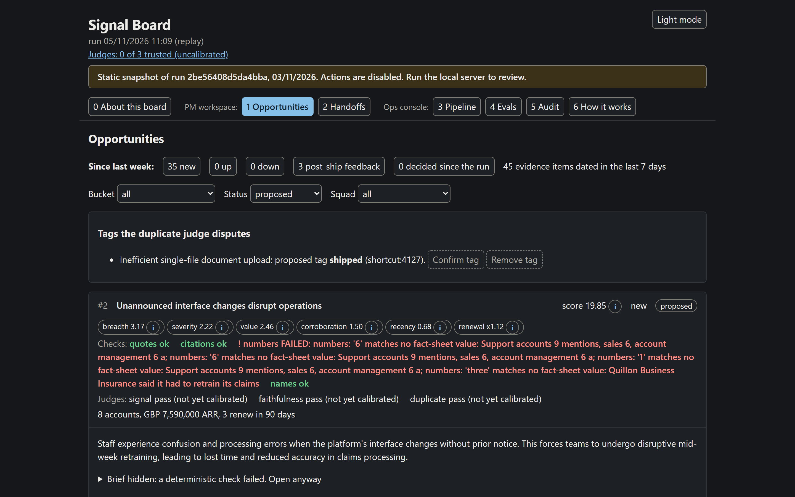
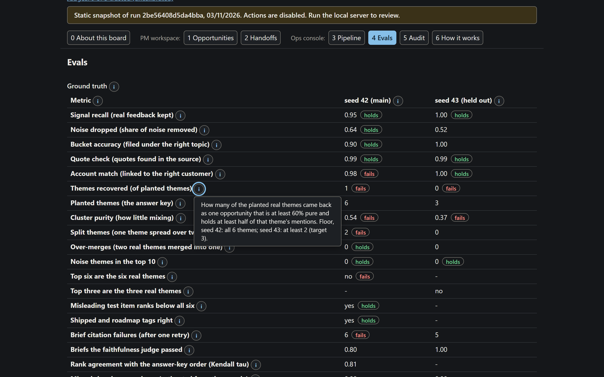
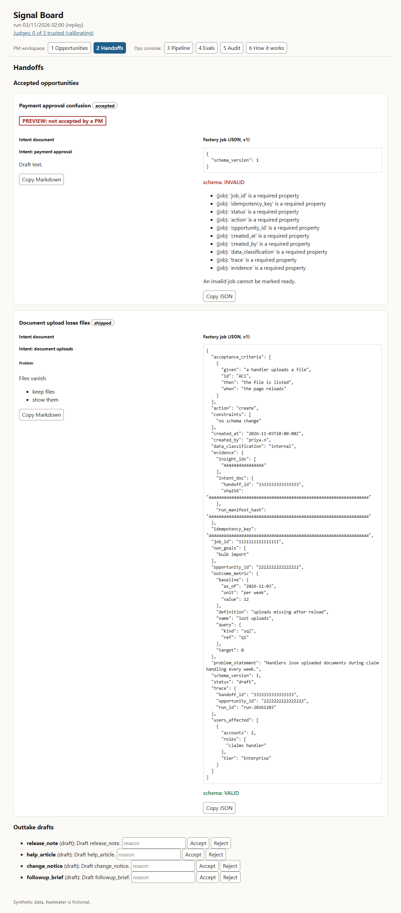

# Keelwater Agentic Software Factory: the product lifecycle layer

By Andras Fugedi

**Status (04/11/2026):** the Signal Engine is built, merged and checked end to end: ingest, triage, extraction, clustering, ranking, briefs, judges, the Signal Board and handoff drafts all run, and replay reproduces the recorded run. The quality floors do not all hold. On the main seed the pipeline recovers 2 of the 6 planted themes, and the results and limits below say so plainly. The repo is frozen on 05/11/2026.

Keelwater is a fictional claims-handling software company whose engineers already write most of their code with AI. This repo plans the layer around its engineering factory: how work is found, decided, specified, released and adopted, with agents doing the work and people passing five gates. The working piece is the **Signal Engine**, a nightly pipeline that turns sales calls, support tickets, onboarding and account-review calls and session analytics into a ranked, evidence-backed list of opportunities that a PM reviews every Monday. Code checks every quote against its source, every model call is logged, and the three AI judges show "uncalibrated" until enough blind PM labels certify them.

## Start here

| Time you have | Read | What you get |
|---|---|---|
| 5 minutes | [The presentation (8 slides)](site/presentation/index.html) | The whole story, answer first: diagnosis, agentic lifecycle, what to tell the board, Part 2 running, how AI was used. One file, opens with a double-click |
| 5 minutes | [Two-page diagnosis and 90-day plan](docs/keelwater-part1-two-pager.pdf) ([source text](docs/part1-diagnosis-and-plan.md)) | Where the lifecycle loses time, the agentic lifecycle, 30/60/90 days, adoption, what to tell the board |
| 2 minutes | [Signal Board snapshot](site/index.html) | The page a PM uses each week; opens with a double-click, no install |
| 15 minutes | [Architecture](docs/architecture.md) and [diagrams](docs/diagrams/) | Pipeline stage by stage, models, data model, CLI, production on AWS |
| A sceptic's question | [How accuracy is kept](docs/evals.md) | Failure modes, planted ground truth, held-out seed, judge certification, drift, change control |
| Interest in method | [How this was built with AI](docs/ai-usage.md) | What AI did, where it was trusted or overridden, one error it made and how it was caught |
| 10 minutes | [Delegation ruleset](docs/delegation.md) | How the factory delegates work across models, the evidence behind it, and how telemetry keeps routing honest |

## Screenshots

The Signal Board on synthetic data (all customers and numbers are invented).







## The problem in five lines

1. Keelwater's engineers generate most code with AI, so the cost of building is falling fast.
2. Coding and testing are only about 25-35% of idea-to-launch time ([Bain](https://www.bain.com/insights/from-pilots-to-payoff-generative-ai-in-software-development-technology-report-2025/)); even at zero, about 20 of the 50 points needed to halve delivery must come from elsewhere.
3. Left of build: feedback arrives by four routes and nobody consolidates it, there is no shared spec, decisions go unwritten, and PMs spend about a third of the week on status.
4. Right of build: daily releases push change cost onto regulated customers who retrain claims handlers, and PR review queues grow as code volume rises.
5. The constraint has moved to deciding what to build and getting it adopted. This repo designs both sides and builds the first piece.

## The agentic product lifecycle at a glance

Seven stages, five human gates. Agents read, draft and check; a named person passes each gate.

```mermaid
flowchart LR
  subgraph LEFT["Product lifecycle layer: left of build"]
    S["Sense"] --> D["Decide"]
    D --> G1{{"Gate 1: PM accepts opportunity"}}
    G1 --> DF["Define"]
    DF --> G2{{"Gate 2: Trio signs off intent"}}
  end
  subgraph FACTORY["Platform team: engineering factory"]
    B["Build"] --> G3{{"Gate 3: engineer reviews and merges PR"}}
    G3 --> R["Release"]
    R --> G4{{"Gate 4: PM and customer success approve bundle"}}
  end
  subgraph RIGHT["Product lifecycle layer: right of build"]
    E["Enable"] --> G5{{"Gate 5: product marketing accepts comms"}}
    G5 --> L["Learn"]
  end
  G2 -- "intent doc + factory job" --> B
  G4 -- "announced bundle" --> E
  L -. "outcomes and labels" .-> S
```



Diagrams: [A, the lifecycle and gates](docs/diagrams/agentic-pdlc.png) ([interactive](docs/diagrams/agentic-pdlc.html)) and [C, production on AWS](docs/diagrams/production-architecture.png) ([interactive](docs/diagrams/production-architecture.html)). Diagram B, the nightly run data flow, was cut for time; its content is the Mermaid chart in [architecture section 3](docs/architecture.md) and the pipeline chart below.

Who owns what:

- **Product lifecycle layer (product operations owns):** Sense, Decide, Define, Enable and Learn; gates 1, 2 and 5; the schemas, evals, judges and PM adoption; and a scheduled job runner inside the VPC for these agents. It is a job runner, not a coding-agent harness, and moves onto the platform harness if that gains scheduling.
- **Engineering factory (platform team owns):** Build and the release pipeline, with gate 3. Gate 4 sits in their pipeline and is product-owned.
- **The contract:** an intent document plus a factory job that validates against a versioned JSON Schema both teams own ([draft v1](docs/contracts/factory_job.schema.json)). The job carries evidence references (insight ids, run manifest hash) and a de-identified problem statement; quotes and account names resolve only inside the VPC. The factory may reject a job with a reason. Product ops asks the platform team for an intake API, model gateway access with per-team cost tags, OpenTelemetry traces into self-hosted Phoenix, preview environments and demo videos, and a flag service with per-customer cohorts ([ADR-011](docs/decisions.md)).
- **Deploy daily, release in bundles:** code still reaches production daily behind flags; customers get an announced monthly bundle with a preview, and those who want changes sooner join opt-in early-access cohorts ([ADR-012](docs/decisions.md)).

## Part 2: the Signal Engine

### What a PM gets every Monday

- A "since last week" strip (new opportunities, big movers and post-ship feedback), then the ranked list. The top 10 each carry a cited brief and the score split into its factors. The target is a review of the top 10 in 30 minutes.
- The customers' exact words, linked to the moment in the source (Gong timestamp, Intercom conversation, Fireflies sentence, FullStory window), each ticked once code has verified it.
- Affected accounts with ARR, tier and renewal date. Missing HubSpot data shows as "not in HubSpot"; nothing is guessed.
- A check line on every brief naming any check that failed and each judge's status, such as "uncalibrated: 0 of 50 per class".
- Actions: accept (it asks for confirmation, then drafts the intent document and factory job), merge, reject with a reason, park as "needs more evidence", or reassign to another squad. Every action can be undone for 10 seconds.
- A short weekly blind label panel (20 judged items with the verdicts hidden) plus 40 sampled noise drops: about 45 minutes for one PM, rotating.

### The pipeline

```mermaid
flowchart LR
  SRC["Sales calls, support tickets, onboarding and account calls, sessions"] --> SEG["Segment (code): customer turns plus unquotable context, idle session time cut"]
  SEG --> TRI["Triage (decision model): signal? bucket? severity?"]
  TRI -- "dropped: 40 a week sampled" --> NQ["Noise audit queue (PM)"]
  TRI -- "signal or unsure" --> EXT["Extract (cheap model), quote check (code)"]
  EXT --> CL["Enrich from HubSpot, cluster, match roadmap and shipped"]
  CL --> RK["Rank (formula)"]
  RK --> BR["Brief, top 10 only (strong model, cited)"]
  BR --> JD["3 judges (different model family)"]
  JD --> SB["Signal Board: PM decides"]
  SB -- "accept" --> HO["Intent doc + factory job"]
  SB -. "blind labels" .-> JD
```



The demo runs on synthetic data: 30 fictional insurers (£15.44m ARR) and about 200 records across seven tools in their native export shapes, roughly 1,200 snippets after segmentation. A second, held-out seed (about 40% of the volume, three unseen themes and one noise theme) is never used for tuning, and every report shows both seeds ([data spec](docs/data.md)).

### One piece of feedback, end to end

This is the designed path, and the quote is illustrative; the theme and accounts are from the planted data. The recorded run recovered only 2 of the 6 planted themes (see Results), so a given theme may not follow this path.

1. **Sales call.** On a Gong call, the Head of Claims Operations at Wexmoor Motor (£1.95m ARR) says that when the approver is on leave, "anything over a handler's limit just sits there".
2. **Connect and segment.** Code links the call to Wexmoor through Gong's HubSpot context and keeps the customer's turns. The account executive's preceding turn goes along as context, and nothing in it can be quoted.
3. **Triage.** In about 0.2 seconds the decision model marks the turn as product signal, bucket "reserves and payments", severity 3. The small talk in the same call is dropped and logged.
4. **Extract.** A cheap model writes the problem and the verbatim quote; code finds that quote in the customer's turn and stores the exact span.
5. **Cluster and rank.** The insight joins the nearest existing opportunity, "Reserve approvals stall when the approver is away", alongside support tickets and account-review calls: 7 accounts, £5.42m ARR, three routes. The formula ranks it and the board shows every factor.
6. **Brief and judges.** A strong model writes a brief that cites each insight; code checks that every number matches the store. The signal and duplicate judges pass it as real signal, distinct from the roadmap's "Reserve history audit export" in the same bucket. Neither judge is certified, and the check line says so.
7. **PM decision.** On Monday the PM reads the brief and evidence, clicks Accept and confirms. That writes an audit event with her name. The accept is stored as an implicit label, but only blind labels count towards certifying a judge.
8. **Handoff.** An agent drafts the intent document (problem, evidence, outcome metric, acceptance criteria, non-goals) and a factory job that must validate against the schema. The Trio signs it off at gate 2 before the factory sees it.

## Why trust it

### How is accuracy maintained?

Code checks what code can: every quote must appear in the customer's own words, every citation must resolve, every number in a brief must equal the stored value, and no model ever picks an account. A planted ground truth (six real themes, two noise themes, a contradiction, one shipped and one on-roadmap theme) scores every run. The gates include the exact top-6 set on the main seed, and no prompt or model change ships if a gated metric falls. The held-out seed checks that the tuning generalises, and a two-batch replay (September, then October) checks that opportunity ids persist and no planted theme splits in two.

Three binary judges from a different model family check faithfulness, real signal and duplication; a cluster-coherence judge is designed but not built. A judge is certified only with at least 50 blind PM labels per class on a held-out set and a Wilson 95% lower bound of at least 0.75 on both its true-positive and true-negative rates (target point estimate 0.90). No judge reaches that in the demo, so the board shows "uncalibrated: 0 of 50 per class". Details in [evals.md](docs/evals.md). In the recorded run several of these gates fail; the Results section lists which.

### How is noise kept out?

Five filters run in sequence, each with a measured leak rate. Segmenting keeps internal speakers only as context that cannot be quoted, and removes Fin's own replies and idle session time. Triage drops an item only when it is at least 90% sure it is noise. A fixed weekly sample of 40 drops, weighted towards the borderline ones, is re-weighted to estimate the miss rate, so the audit cost stays flat as volume grows. Unsure items go forward flagged. Extraction needs a stated problem and a verifiable quote. The ranking formula rewards breadth and corroboration: an adversarial probe (one strategic account, renewing, severity 4, three routes) must rank below all six real themes. The planted noise (renewal-price haggling from big accounts, customer-side IT outages) must never reach the top 10. See [evals.md section 1](docs/evals.md).

### How does work hand off between agents and people?

Intake is a fixed workflow of typed steps ([ADR-001](docs/decisions.md)). Each stage reads and writes schema-validated records, is idempotent per run and can resume. Every opportunity moves through one status machine: `new > proposed > accepted | merged | rejected | parked > intent_drafted > in_factory > shipped > enabled > measured`; reassigning changes the squad, not the status. An agent can only move an item into the state its stage owns. Only a named person can pass a gate, and the server checks the actor. Every move writes an audit event with actor, time, input hash, model and prompt version to an append-only, hash-chained table. See [architecture sections 4 and 7](docs/architecture.md).

## Models and cost

One OpenAI-compatible gateway serves every model stage, triage included. The demo runs open-weight models through OpenRouter. Only GLM 5.3 is confirmed on Bedrock, so moving to the `aws` profile means confirming or self-hosting the rest, plus one re-qualification run of the eval suites ([ADR-002](docs/decisions.md)). Routing follows the cost of being wrong. Prices are USD per million tokens, in / out, read on OpenRouter on 05/11/2026:

| Job | Tier | `demo` profile (OpenRouter) | `aws` profile (inside the VPC; open weights) |
|---|---|---|---|
| Triage | Decision model | Clef (`cloudflare/clef`, 27B, 0.192 / 0), falling back to Clef Flash (`cloudflare/clef-flash`, 9B, 0.018 / 0): decision models on OpenRouter's Decisions API with the same key, about 50 ms a call | Clef weights self-hosted in the VPC; availability on Bedrock not confirmed (INFERRED). Later a classifier trained on PM labels |
| Extract | Cheap | Qwen3.8 Flash (`qwen/qwen3.8-flash`, 0.15 / 0.47), falling back to Qwen3.8 27B | Qwen3.8 Flash; availability on Bedrock not confirmed (INFERRED) |
| Cluster labels | Cheap | Qwen3.8 27B (`qwen/qwen3.8-27b`, 0.023 to 0.029 / 1.28 to 1.575; two pages differ), falling back to Qwen3.8 Flash | Qwen3.8 27B; availability on Bedrock not confirmed (INFERRED) |
| Embeddings | Open weights | Qwen3 Embedding 8B (`qwen/qwen3-embedding-8b`, 0.01), falling back to OpenAI text-embedding-3-large | Qwen3-VL-Embedding-8B, the newest Qwen embedding model (open weights, not on OpenRouter); availability on Bedrock not confirmed (INFERRED) |
| Brief and handoff, top 10 only | Strong | DeepSeek V4.1 Flash (`deepseek/deepseek-v4.1-flash`, reasoning off, 0.15 / 0.60), the configured fallback. Qwen3.8 Max (`qwen/qwen3.8-max-0902`, 2.00 / 6.00) was the primary, but its reasoning cannot be switched off and ran out of tokens on 2 of 4 test briefs even at 8,000, so the live run used the fallback | Qwen3.8 Max; availability on Bedrock not confirmed (INFERRED) |
| Judges | Different family from the writer | GLM 5.3 (`z-ai/glm-5.3`, reasoning always on, effort low, 0.0699 / 1.40), falling back to DeepSeek V4.1 Flash | GLM 5.3 as `global.zai.glm-5.3` on Bedrock (FOUND, 05/11/2026); global routing cannot guarantee UK data residency |
| Outtake | Cheap | Qwen3.8 Flash, falling back to DeepSeek V4.1 Flash | Qwen3.8 Flash; availability on Bedrock not confirmed (INFERRED) |

- **Model ids:** the build probes each id and uses the stage's fallback in `config/models.yaml` if one is missing on OpenRouter.
- **Family rule:** writers are Qwen with DeepSeek as fallback (in the 05/11/2026 run brief and handoff used the DeepSeek fallback, as the table says); judges are GLM with DeepSeek as fallback. A brief written by DeepSeek is never graded by a DeepSeek judge: that judgement is stored as `not_independent`, shown, and left out of pass counts. Qwen 4 is not released (05/11/2026); it is the planned swap for brief and handoff, once the same eval suites qualify it.
- **Replay profile:** recorded responses, no network, no keys, byte-for-byte reproducible from the run manifest.
- **Synthetic data** was written by Qwen3 VL 235B Instruct (`qwen/qwen3-vl-235b-a22b-instruct`), a family no judge belongs to, so no judge grades its own family's text. The committed seeds were made with it and are not regenerated. Mistral Large was dropped: the data is invented, so the cheapest model that passes the generator's checks is enough. DeepSeek V4.1 Flash (reasoning off) is the recorded fallback.
- **Cost:** <!-- generated:cost:start -->tokens come to about USD 0.17 per nightly run at demo volume, 1.7 at 10x and 17 at 100x (estimated from list prices and the recorded token counts of the demo run, INFERRED).<!-- generated:cost:end --> At scale the real costs are GPU hosting and PM attention, so routing exists to protect attention and latency as much as money. Decision calls run with a concurrency of 50 or more.
- **Live-run caps:** the OpenRouter key has a hard USD 10 limit for the whole build; the per-step caps inside it total about USD 7.80, with the first live run capped at USD 1.50, and the plan expected the whole build to cost about USD 3.50. The key's own usage figure read USD 4.16 of 10 before the fresh live proof; the issue reports add up to about 1.6, and [build-plan.md](docs/build-plan.md) lists the gap as unexplained. The #62 re-run on the current routing moved it from USD 4.53 to 6.67 (cap 3.00). Judges are seeded with 60 items each. OpenRouter requests deny data collection.

## Quickstart

Needs Python 3.12 and uv on Windows, macOS or Linux; no Docker. Every subcommand and flag is in the CLI table in [architecture.md](docs/architecture.md section 11), and `tests/test_docs_cli.py` fails if a documented command is not in the CLI.

```bash
uv sync
uv run keelwater run                         # replay: full pipeline from recorded responses, no keys, no network; prints MATCH or DIFF
uv run keelwater eval --suite all            # ground truth, held-out seed, stability, judges; exits 0 when every floor holds
uv run keelwater board serve                 # local Signal Board with working actions
uv run keelwater render static               # rebuilds site/index.html
```

Replay from a clean clone with no keys: `uv sync` took 9 s and `uv run keelwater run` took 58 s and printed MATCH (04/11/2026, Windows 10 laptop), inside the 2-minute target.

To look without installing anything, double-click `site/index.html`: a static snapshot with actions disabled.

Live run: copy `.env.example` to `.env`, add `OPENROUTER_API_KEY`, then run `uv run keelwater run --profile demo`. A fresh live run takes longer than replay and costs real money; the Results section has the measurement.

## Results

All figures come from the committed reports in `reports/eval/` and are measured on synthetic data (docs/evals.md section 7 says which numbers are synthetic and which are real clicks). They measure the pipeline against its own planted-truth gates and say nothing about accuracy on real customers.

<!-- generated:results:start -->
Verdict: the floors fail on seed 42, on seed 43 and on stability. The judge suite passes only because no judge can be certified without real PM labels. `eval --suite all` exits 1. The tables are the latest run of each suite in `reports/eval/`; the numbers are the same in the board's Evals tab.

**Seed 42** (`eval --suite ground-truth`, report `ground-truth-9a0156dd325d49fc`; the gates are in [evals.md section 4.2](docs/evals.md)). Synthetic.

| Metric | Result | Floor | Holds |
|---|---|---|---|
| Signal recall | 0.95 | 0.90 | yes |
| Noise-drop rate | 0.64 | 0.60 | yes |
| Bucket accuracy | 0.90 | 0.75 | yes |
| Quote verification | 0.99 | 0.93 | yes |
| Account attribution | 0.98 | 1.00 | no |
| Themes recovered | 1 of 6 | 6 of 6 | no |
| Mean purity | 0.54 | 0.75 | no |
| Split themes | 2 | at most 1 | no |
| Over-merges | 0 | at most 1 | yes |
| Noise themes in the top 10 | 0 | 0 | yes |
| Top-6 set equals the six real themes | no | yes | no |
| Adversarial probe ranks below all six | yes | yes | yes |
| Citation failures after retry | 6 | 0 | no |
| Faithfulness pass rate (reported) | 0.80 | not gated | n/a |

**Seed 43, held out** (`eval --suite holdout`, report `holdout-b6cb1749832b493d`; floors in [evals.md section 4.3](docs/evals.md)). Synthetic.

| Metric | Result | Floor | Holds |
|---|---|---|---|
| Signal recall | 1.00 | 0.85 | yes |
| Quote verification | 0.99 | 0.93 | yes |
| Account attribution | 1.00 | 1.00 | yes |
| Themes recovered | 0 of 3 | 2 of 3 | no |
| Mean purity | 0.37 | 0.75 | no |
| Noise themes in the top 10 | 0 | 0 | yes |
| Citation failures after retry | 5 | not gated | n/a |
| Noise-drop rate, bucket accuracy (reported) | 0.52, 1.00 | not gated | n/a |

**Stability** (`eval --suite stability`, report `stability-d32ee635e4994de5`): fails. No September opportunity lost its id (0 of 12) and no membership shrank, but 2 planted themes are held by two opportunities of 25% or more each.

**Judges** (`eval --suite judges`, report `judges-d29d0a9d635c47d9`; passes, none certified). The `synthetic_seed` rows are constructed items and never certify (evals.md section 7). The `real_pm` rows hold 0 of 50 labels per class, so every judge is uncalibrated. Held-out agreement on the constructed items, with 95% intervals:

| Judge | True-positive rate | True-negative rate |
|---|---|---|
| signal | 1.00 (0.85 to 1.00) | 0.85 (0.64 to 0.95) |
| duplicate | 0.95 (0.78 to 0.99) | 0.80 (0.55 to 0.93) |
| faithfulness | 1.00 (0.51 to 1.00) | 0.75 (0.30 to 0.95) |

**Earlier run (previous routing, 04/11/2026)**, same suites and floors:

| Metric | Earlier | Now | Floor |
|---|---|---|---|
| Seed 42: Signal recall | 0.95 | 0.95 | 0.90 |
| Seed 42: Noise-drop rate | 0.64 | 0.64 | 0.60 |
| Seed 42: Bucket accuracy | 0.90 | 0.90 | 0.75 |
| Seed 42: Quote verification | 0.99 | 0.99 | 0.93 |
| Seed 42: Account attribution | 0.98 | 0.98 | 1.00 |
| Seed 42: Themes recovered | 2 of 6 | 1 of 6 | 6 of 6 |
| Seed 42: Mean purity | 0.59 | 0.54 | 0.75 |
| Seed 42: Split themes | 2 | 2 | at most 1 |
| Seed 42: Over-merges | 0 | 0 | at most 1 |
| Seed 42: Noise themes in the top 10 | 0 | 0 | 0 |
| Seed 42: Citation failures after retry | 7 | 6 | 0 |
| Seed 43: Signal recall | 1.00 | 1.00 | 0.85 |
| Seed 43: Quote verification | 1.00 | 0.99 | 0.93 |
| Seed 43: Account attribution | 1.00 | 1.00 | 1.00 |
| Seed 43: Themes recovered | 0 of 3 | 0 of 3 | 2 of 3 |
| Seed 43: Mean purity | 0.39 | 0.37 | 0.75 |
| Seed 43: Noise themes in the top 10 | 1 | 0 | 0 |
<!-- generated:results:end -->

Cost, tokens and latency are real `model_call` rows from the recorded live runs; everything else above is measured on planted data. **Live re-run on the current routing (05/11/2026, #62):** one run per seed, thresholds and prompts unchanged. Before the run, a smoke on the September batch found that Qwen3.8 Flash and Qwen3.8 27B reason by default and ran out of tokens (14 of 60 extract calls), so extract, cluster labels and outtake run with reasoning off. Qwen3.8 Max cannot switch reasoning off, so brief and handoff moved to their configured fallback, DeepSeek V4.1 Flash, with a 3,000-token limit. The smoke's triage, extract and cluster recordings had the same requests as the seed 42 run and were reused by it. Seed 42 then took 2 min 30 s (metered USD 0.0269), seed 43 took 3 min (USD 0.0589), and the four suites took 6 min live and 5 min 30 s from the recording. The key's usage rose from USD 4.53 to 6.67 of 10 (USD 2.13 against a cap of 3.00), most of it on the smoke runs that found the token overruns. Seed 42 recovered 1 of 6 themes against 2 of 6 before; both seeds and stability still fail their floors. Replay prints MATCH for both seeds. No brief needed the `not_independent` rule, because the judge (GLM 5.3) and the writer (DeepSeek) are different families. The earlier fresh live proof (04/11/2026, previous routing) completed in 15 min 2 s of run time for metered USD 0.1977, after a budget stop and one `APIConnectionError`; the gateway still does not retry that error.

## Production path

Everything that touches customer data runs inside Keelwater's own AWS VPC, with no extra vendor handling it, and every step is auditable. Production triage runs in the VPC from day one. The demo's Clef weights are open and can be self-hosted on one GPU, so demo and production can run the same triage model, and no closed hosted model sits in the triage path. Any shadow or canary comparison is between two in-VPC backends. The `aws` profile's egress allow-list excludes OpenRouter, and a test fails if any `aws` host is outside the VPC endpoint list. SQLite becomes Postgres behind one repository layer.

| Concern | Production choice |
|---|---|
| Network | One AWS VPC (eu-west-2); connectors reach the SaaS tools through an egress allow-list |
| Models | Amazon Bedrock through VPC interface endpoints on `bedrock-runtime`, with `call_id` passed as request metadata so invocation logs join `model_call`; endpoints and residency verified at deployment (INFERRED) |
| Store | RDS Postgres with pgvector; Metabase reads a reporting schema |
| Orchestration | EventBridge Scheduler and Step Functions, one Fargate task per stage |
| Telemetry | Arize Phoenix, self-hosted on Fargate in private subnets, with KMS, retention and changed default credentials |
| Audit | CloudTrail, Bedrock invocation logs with KMS and retention, the hash-chained `audit_event` table, raw data in S3 with object lock in governance mode, bounded retention (about 400 days) and KMS |

## How this repo was built

An orchestrating AI produced the plan overnight on 02-03/11/2026, sending research subagents to check tools, prices and evidence (sources in `docs/research/`) and review subagents to attack each draft. For the build, one orchestrating session dispatches each GitHub work order to a coding agent in its own git worktree, has a reviewer subagent check every pull request, and squash-merges it after that check passes; a second session makes the diagrams and the PDF. Human gates cover rules and permissions, spending, publishing and anything customer-facing. Author time is about 4 hours, spent on direction, decisions and review. The plan budgets about 22 agent-hours (20.25 on pipeline and board work orders, 1.75 on diagrams and the PDF) plus orchestration. The work orders and the as-executed record are in [build-plan.md](docs/build-plan.md); the longer account is [ai-usage.md](docs/ai-usage.md).

<!-- tokens:start -->

Measured from the session logs, the build used 628,278,423 tokens across all models, an API cost equivalent of about USD 149; the table is in [ai-usage.md](docs/ai-usage.md).

<!-- tokens:end -->

## How I used AI

The author's account will be written in #16. Until then this is a candidate list of real overrides taken only from merged pull request bodies, the final report comments on the work-order issues and the adversarial review comments on #13. Each is **for the author to confirm in #16**; none is an invention, and each links to its source.

| # | What the AI did or proposed | The override | Source |
|---|---|---|---|
| C1 | Demo triage ran on Jev through a separate TypeSafe key. | Author replaced it with Cloudflare Clef via OpenRouter's Decisions API (04/11/2026), so demo and production triage can share open weights and no closed hosted model sits in the triage path. | [PR #25](https://github.com/fugedibobo/Keelwater_Agentic_Software_Factory/pull/25) |
| C2 | The synthetic-data generator used Mistral. | After empty output and failed rules, the author ruled it out; `qwen/qwen3-vl-235b-a22b-instruct` passed, with data collection allowed for that stage only. | [PR #46](https://github.com/fugedibobo/Keelwater_Agentic_Software_Factory/pull/46), [#2 report](https://github.com/fugedibobo/Keelwater_Agentic_Software_Factory/issues/2#issuecomment-6623164926) |
| C3 | Prompt text alone did not make the generator follow the content rules. | After repeated smoke failures (checkpoints 03:37 and 04:32), every must-contain rule moved from prompt text into code-inserted schema slots in the per-record output. | [checkpoint 03:37](https://github.com/fugedibobo/Keelwater_Agentic_Software_Factory/issues/2#issuecomment-6621870144), [checkpoint 04:32](https://github.com/fugedibobo/Keelwater_Agentic_Software_Factory/issues/2#issuecomment-6622623569), [#2 report](https://github.com/fugedibobo/Keelwater_Agentic_Software_Factory/issues/2#issuecomment-6623164926) |
| C4 | The data spec and the leak rules disagreed over planted mentions. | Orchestrator ruling: the data spec wins, so mentions in raw data must contain a theme synonym; the synonym ban applies to prompts and config only. | [PR #33](https://github.com/fugedibobo/Keelwater_Agentic_Software_Factory/pull/33) |
| C5 | The generated account list summed to a different ARR than the stated total. | One account's ARR was changed from GBP 45,000 to 46,000 so the listed sum equals GBP 15,440,000. | [PR #33](https://github.com/fugedibobo/Keelwater_Agentic_Software_Factory/pull/33) |
| C6 | The triage build passed its own tests. | The independent check returned REWORK: snippets vanished on replay misses, the reconciliation test was tautological, one test was flaky. | [#4 report](https://github.com/fugedibobo/Keelwater_Agentic_Software_Factory/issues/4#issuecomment-6620686088) |
| C7 | A brief-writing function read the shared database connection without its lock. | Found as a flake while building a later stage; fixed in a separate rework. | [PR #32](https://github.com/fugedibobo/Keelwater_Agentic_Software_Factory/pull/32) |
| C8 | The coding agent stopped three times on the first work order (sandbox limits) and left partial code. | A Sonnet builder finished it; the check then returned REWORK for a missing scratch folder. | [#1 report](https://github.com/fugedibobo/Keelwater_Agentic_Software_Factory/issues/1#issuecomment-6619922654) |
| C9 | The rule to hand over instead of compacting applied to every session. | Author instruction: it applies to planning chats only, never to build sessions. | [PR #42](https://github.com/fugedibobo/Keelwater_Agentic_Software_Factory/pull/42) |
| C10 | Codex Sol's adversarial review of the finished build returned a BLOCK with six high and one medium finding (budget cap, citation numbers, actor check, undo and outbox, unsafe factory job, audit replace, absolute paths). | Author ruled that the budget, citation and path fixes be built and the outbox ordering documented. Sonnet builders fixed them (PRs #51 and #52) after codex terra stalled; two scoped re-checks followed, and the last still blocked on three items (1, 2 and 7), which went into Limits with no third loop. | [sol review](https://github.com/fugedibobo/Keelwater_Agentic_Software_Factory/issues/13#issuecomment-6625795243), [author ruling](https://github.com/fugedibobo/Keelwater_Agentic_Software_Factory/issues/13#issuecomment-6629466728), [re-check](https://github.com/fugedibobo/Keelwater_Agentic_Software_Factory/issues/13#issuecomment-6630268863), [PR #51](https://github.com/fugedibobo/Keelwater_Agentic_Software_Factory/pull/51), [PR #52](https://github.com/fugedibobo/Keelwater_Agentic_Software_Factory/pull/52) |
| C11 | After the first live run the seed 42 floors failed (1 of 6 themes at the time). The orchestrator offered three options and recommended an extract filter. | Author chose option 1 but capped it: decide from seed 42 only, one re-run on each seed, no further loop. The floors still fail and ship as measured. | [needs-decision](https://github.com/fugedibobo/Keelwater_Agentic_Software_Factory/issues/7#issuecomment-6625438210), [ruling](https://github.com/fugedibobo/Keelwater_Agentic_Software_Factory/issues/7#issuecomment-6629466310), [final report](https://github.com/fugedibobo/Keelwater_Agentic_Software_Factory/issues/7#issuecomment-6631522428), [PR #55](https://github.com/fugedibobo/Keelwater_Agentic_Software_Factory/pull/55) |
| C12 | The plan's first judge model, an older GLM release, was the judge. | It ignored the `json_schema` response format, so the runner switched to `glm-5.3` and recorded the swap. | [#7 report](https://github.com/fugedibobo/Keelwater_Agentic_Software_Factory/issues/7#issuecomment-6631522428), [PR #48](https://github.com/fugedibobo/Keelwater_Agentic_Software_Factory/pull/48) |
| C13 | The Phoenix bridge was specified to show human labels beside judge verdicts. | No PM labels exist, so the report states the cut: 0 human annotations, code path unit-tested with fakes only. | [#10 report](https://github.com/fugedibobo/Keelwater_Agentic_Software_Factory/issues/10#issuecomment-6629808276) |
| C14 | A seed 43 replay missed its recorded response. | The runner re-recorded it; coalescing identical in-flight requests is listed as a follow-up and not built. | [#7 report](https://github.com/fugedibobo/Keelwater_Agentic_Software_Factory/issues/7#issuecomment-6631522428), [PR #55](https://github.com/fugedibobo/Keelwater_Agentic_Software_Factory/pull/55) |

## Limits

What the results above do not show, and what the review did not fix. Each line links to its evidence.

- **Clustering is the main limit.** Average-linkage cosine clustering cannot separate planted themes that share vocabulary, so <!-- generated:limits-clustering:start -->seed 42 recovers 1 of 6 themes and seed 43 recovers 0 of 3<!-- generated:limits-clustering:end -->. Citation failures come from the brief stage. Diagnosis and the capped extract-filter fix: [#7 final report](https://github.com/fugedibobo/Keelwater_Agentic_Software_Factory/issues/7#issuecomment-6631522428), [author ruling](https://github.com/fugedibobo/Keelwater_Agentic_Software_Factory/issues/7#issuecomment-6629466310). The floors still fail and ship as measured.
- **No human labels.** The optional PM review (#15) did not run. No judge is certified, and Phoenix shows 0 human annotations beside the judge verdicts ([#10 report](https://github.com/fugedibobo/Keelwater_Agentic_Software_Factory/issues/10#issuecomment-6629808276)).
- **Handoff drafts fail the citation check.** In the #13 verification run, live previews (`handoff <id> --preview`) of three top-scoring opportunities all came back invalid on the citation checks: numbers that match no fact-sheet value, customer names not tied to a cited insight, and a quote that is not from a cited insight. Nothing invalid reaches a factory job, and the Handoffs tab shows no accepted opportunities. Measured by this verification run; it has no separate issue.
- **Outbox ordering (finding 4b).** A board action commits before its replay record is written to the outbox, so a crash in between can lose the JSONL record, and a partial append needs recovery. Documented, not fixed, per the [author ruling](https://github.com/fugedibobo/Keelwater_Agentic_Software_Factory/issues/13#issuecomment-6629466728); evidence in [sol's first review](https://github.com/fugedibobo/Keelwater_Agentic_Software_Factory/issues/13#issuecomment-6625795243).
- **The budget cap relies on configured prices (sol item 1).** A provider-reported cost above the reserved bound is booked as actual, so the cap can be overshot; the OpenRouter key limit of USD 10 is the real stop. [Sol re-check](https://github.com/fugedibobo/Keelwater_Agentic_Software_Factory/issues/13#issuecomment-6630268863).
- **Citation exemptions apply sentence-wide (sol item 2).** A renewal or ARR mention anywhere in a sentence exempts the numbers in the rest of it, so "Renewals are discussed; uploads fail every 90 days" passes. [Sol re-check](https://github.com/fugedibobo/Keelwater_Agentic_Software_Factory/issues/13#issuecomment-6630268863).
- **The path scrub in `site/` stops at spaces and lists its roots (sol item 7).** A path such as `C:\Users\Other Person\...` can leak its tail, and an unlisted root such as `/data/...` survives. The static page is rendered from the main checkout, and the pre-publish scan also searches `site/` for absolute-path text. [Sol re-check](https://github.com/fugedibobo/Keelwater_Agentic_Software_Factory/issues/13#issuecomment-6630268863).
- **Replay timing.** Replay from a clean clone finished in 58 s, inside the 2-minute target. The canonical read-through demo run (profile `demo`, every call a cache hit) took 2 min 17 s on the same laptop; it is not the keyless replay path.
- **No real login.** The demo board accepts only the synthetic people in `config/people.yaml`, an allow-list that trusts a header; production needs SSO.
- All data is synthetic, so every figure measures the pipeline against planted truth, not real customers.
- Replay reproduces recorded responses; a changed prompt or model needs a live run and a new recording.
- The Split action returns 501 (not built). The cluster-coherence judge is designed, not built.
- The static site disables actions; Audit filters in static mode cover the first 100 rows only.
- Connectors are file exports, not live APIs.

## Assumptions and what was cut

Assumptions (flagged throughout the docs):

- Keelwater's tools: Gong (sales only), Fireflies (everyone else), Intercom with Fin, FullStory, HubSpot (ARR, tier and renewal date only, because it is messy), Notion, Shortcut, and Metabase on production Postgres.
- Customer data stays in Keelwater's AWS VPC in production, with a full audit trail; anonymising is not required.
- PMs give a half-day of labelling at day 30 and about 30 minutes a week after that.
- All data is invented: 30 insurers and 4 prospects, data window 01/09/2026-31/10/2026, every run dated 03/11/2026, plus the held-out seed. No health data.

Cut, to fit about 4 hours of author time:

- Diagram B, the nightly run data flow: the diagram tool needs about 140 px between stages for 17 exact edge labels, so five stages do not fit under 1240 px ([PR #23](https://github.com/fugedibobo/Keelwater_Agentic_Software_Factory/pull/23)). The Mermaid chart stands in.
- Board extras (build-plan cut-list items 5 and 6): design passes beyond the automatic detector, the drill-down side panel (inline details instead), links from the funnel to the Audit tab, the counts or percent toggle and the judge-disagreement drill-down ([PR #35](https://github.com/fugedibobo/Keelwater_Agentic_Software_Factory/pull/35)).
- The optional PM review (#15) and, with it, human labels beside the judge verdicts in Phoenix ([#10 report](https://github.com/fugedibobo/Keelwater_Agentic_Software_Factory/issues/10#issuecomment-6629808276)).
- Live connectors and write-back to Notion, Shortcut, Slack and Intercom.
- Mockup generation from intent documents (designed in Part 1: generated in Define on the real design-system components, signed off by the designer within the Trio gate).
- The shared agent skill library and the metric dictionary beyond v0 (product ops owns a v0 of about 10 lifecycle metrics in the first 60 days; the rest comes later with data engineering).
- Enablement videos and the sales "ask before a demo" agent (designed in Part 1; they need the factory's demo artefacts).
- The cluster-coherence judge, bias-corrected rates, test-set rotation and Phoenix experiments (designed in evals.md; the ground-truth regression covers over-merging in the demo).
- Self-hosted models inside AWS, SSO and multi-user access control.
- Real authentication: the demo board accepts only the synthetic people listed in `config/people.yaml` (an allow-list, not a login), so a header naming one of them is trusted; production needs SSO.
- The engineering factory itself, a delegation meta-harness ([operating rules](docs/delegation.md)); its coding harness belongs to the platform team.

## Repo map

```text
keelwater/
  README.md                          this page
  scripts/                           scan_public.py (pre-publish scan), two-pager and halving-model scripts
  tests/                             pytest suite, including the docs-command and scan tests
  docs/
    part1-diagnosis-and-plan.md      two-page diagnosis and 90-day plan (also as PDF)
    architecture.md                  canonical design: pipeline, models, data model, CLI, production
    evals.md                         failure modes, ground truth, judges, drift, change control
    data.md                          synthetic data specification and generator design
    signal-board.md                  Signal Board specification: PM workspace and ops console
    decisions.md                     decision records (ADRs)
    contracts/                       factory job JSON Schema, draft v1 (the platform contract)
    diagrams.md                      specifications for the three diagrams
    research/                        sourced research notes, 02/11/2026
    diagrams/                        lifecycle (A) and production architecture (C) diagrams, HTML and PNG
    keelwater-part1-two-pager.pdf    the two-page PDF
    build-plan.md                    build-day plan, work orders and as-executed record
    ai-usage.md                      how AI was used, trusted and overridden
  signal_engine/                     pipeline stages, typed contracts, evals, Signal Board app
  prompts/                           versioned prompts per stage
  config/                            model profiles, taxonomy, ranking weights, team map
  contracts/sources/                 per-source export JSON Schemas (the code validates jobs against docs/contracts/)
  generator/                         synthetic data generator, spec and committed model cache
  data/                              native-shape raw exports, both seeds and ground truth
  fixtures/llm_cache/                recorded model responses for replay
  reports/eval/                      committed eval reports
  site/index.html                    static Signal Board snapshot
```
