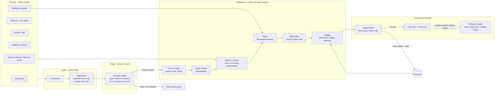

# Architecture: the Keelwater Signal Engine and the product lifecycle layer

Status: planned, build day 03/11/2026. Author: Andras Fugedi. This is the canonical design; other docs refer to it.

## 1. What we are building and why

Keelwater's engineers already generate most code with AI, and a platform team is building the engineering factory (coding agents, guardrails, evals). When build effort approaches zero, the constraints move to either side of the build: deciding what to build (left) and getting what was built adopted by regulated customers (right). This repo designs and demos the **product lifecycle layer** that sits around the engineering factory, and builds one working piece of it end to end: the **Signal Engine**, which turns raw customer feedback into ranked, evidence-backed opportunities that a PM can accept in one click.

Scope of the demo (Part 2 of the task):

| In the demo | Designed, not built |
|---|---|
| Nightly intake from 5 sources (sales calls, support tickets, onboarding calls, account-manager calls, session analytics) using realistic synthetic exports | Live API connectors to the real tools |
| Fast triage with a decision model, cheap extraction, clustering, deterministic ranking, strong-model synthesis | Mockup generation for designers |
| Verified quotes and citations, LLM judges calibrated to PM labels, regression evals on a planted ground truth | Self-hosted models inside AWS |
| Signal Board: a tabbed web page where a PM accepts, rejects or edits opportunities, and every action becomes an eval label | Slack/Notion/Shortcut write-back |
| Handoff: an accepted opportunity becomes an intent document and a factory job request | The engineering factory itself (platform team) |
| Outtake: release note, help-centre article and customer change notice drafted from a shipped story, plus a post-call follow-up brief | Auto-generated enablement videos, pull-model sales agent |

## 2. Requirements

Functional
- F1 Ingest each source in its native export shape and keep the raw record.
- F2 Separate product signal from noise before any expensive model sees it.
- F3 Extract structured insights whose quotes are verifiably present in the source.
- F4 Group insights into opportunities that persist across runs, so trends are visible week to week.
- F5 Rank opportunities with a formula a PM can read and challenge.
- F6 Write an opportunity brief where every claim cites evidence.
- F7 Let a PM accept, merge, reject (with a reason) or edit; record who did what.
- F8 Turn an accepted opportunity into an intent document and a factory job request.
- F9 Draft release-side artefacts from a shipped story for human acceptance.
- F10 Measure accuracy continuously and refuse to call the output trusted until the judges agree with PMs.

Non-functional
- N1 Repeatable: every run has a run manifest (data snapshot hash, config hash, prompt versions, model ids). Replay mode reproduces a run byte for byte with no API keys.
- N2 Auditable: every model call and every human gate decision is logged with actor, time, inputs hash, output hash, model and prompt version.
- N3 Private-network ready: one OpenAI-compatible model interface, so moving from the demo endpoint to a private AWS endpoint is a configuration change.
- N4 Cheap: noise is dropped by a decision model at a fraction of a cent per thousand items; frontier-class models only see the top opportunities.
- N5 Runs on a Windows 10 laptop with Python and no Docker. Demo replay finishes in under 2 minutes; a live run in under 15 minutes.

Constraints and assumptions (flagged)
- A1 Keelwater's tools: Gong (sales only, it is expensive), Fireflies (everyone else, incl. onboarding consultants and account managers), Intercom with the Fin AI agent (support), FullStory (session analytics), HubSpot (accounts; messy, used only for ARR, tier and renewal date), Notion (roadmap, docs), Shortcut (tickets), Postgres with Metabase reading production directly. ASSUMED.
- A2 Customer data must stay inside Keelwater's AWS private network (VPC) in production, with a full audit trail. Data does not need anonymising, it needs auditing. ASSUMED.
- A3 All data in this repo is synthetic and invented. No public dataset was reused (licences and fit; see docs/data.md).

## 3. High-level design



Production view: the same components run inside one AWS VPC. Raw exports land in S3, a scheduled Step Functions workflow runs one task per stage, Postgres (RDS, pgvector) holds the store, models are served by Amazon Bedrock through VPC endpoints or by vLLM on the team's own GPUs, Phoenix runs on Fargate in private subnets, and Bedrock invocation logging plus CloudTrail provide the audit trail. Connectors reach the SaaS tools through an egress allow-list. See section 8.

## 4. The pipeline, stage by stage

The pipeline is a **workflow of typed steps, not a free-roaming agent** (ADR-001). LLMs interpret text and fill typed fields; code validates; the database enforces. Every stage reads and writes typed records (Pydantic models in `signal_engine/contracts.py`), is idempotent per `run_id`, and can be resumed from its last checkpoint.

| # | Stage | Engine | Input -> output | Defensibility check |
|---|---|---|---|---|
| 0 | Connect | code | native export files -> `raw_record` | schema validation per source; raw kept for audit |
| 1 | Segment | code | raw -> `snippet` (customer speaker turns only; tickets split by part; FullStory sessions cut to interaction windows around rage, dead and error clicks) | internal speakers dropped; a 2-hour session becomes minutes of signal before any model runs |
| 2 | Triage | decision model | snippet -> `triage` {is_product_signal p, bucket + confidence, severity 1-4, signal_type} | confidence gates; 5% of dropped noise goes to a human audit queue to measure missed signal |
| 3 | Extract | cheap LLM, JSON schema | kept snippet -> `insight` {problem, verbatim quote, workflow, desired outcome, account} | quote must be found in the source text (normalised match); failures are retried once then rejected |
| 4 | Enrich | code | insight + HubSpot -> ARR band, tier, renewal within 90 days | missing account data marked, never guessed |
| 5 | Cluster | embeddings + LLM label | insights -> `opportunity` (stable id across runs) | new insight joins an existing opportunity above a similarity threshold; opportunities matched against roadmap (Notion) and shipped (Shortcut) are tagged, not re-proposed |
| 6 | Rank | code | opportunities -> score with a visible breakdown | formula, not an LLM (ADR-004) |
| 7 | Brief | strong LLM | top N opportunities -> `brief` with claims citing insight ids | every cited id must exist and belong to the opportunity |
| 8 | Judge | LLM from a different model family | brief -> pass/fail per failure mode with critique | judges are trusted only once calibrated to PM labels (section 6) |
| 9 | Review | PM in Signal Board | brief -> accept, merge, reject (reason code), edit | every action is an audit event and an eval label |
| 10 | Handoff | strong LLM + template | accepted opportunity -> `intent_doc` + `factory_job` JSON | factory job validated against the contract schema agreed with the platform team |
| 11 | Outtake | cheap LLM | shipped story + intent doc -> release note, help article, customer change notice; sales call + shipped features -> follow-up brief | drafts only; a human accepts each one |

### Triage gating (stage 2)

One decision-model call per snippet asks four typed questions at once, so the text is paid for once:
- `is_product_signal` (yes/no probability)
- `bucket` (choice of 10, from `config/taxonomy.yaml`)
- `severity` (score 1-4)
- `signal_type` (bug, feature gap, usability friction, workflow blocker, praise, churn risk, question)

Rules:
- noise with p >= 0.90: dropped, logged, 5% sampled to the noise audit queue;
- signal with bucket confidence >= 0.70: proceeds;
- everything in between: re-triaged by the cheap LLM with the same questions as a JSON schema; if still unsure it proceeds marked `low_confidence`.

Fallback chain if the decision model is unavailable or slow (timeout 1.5 s, two retries with backoff): cheap LLM with the same typed questions; if that fails, the item proceeds as `untriaged`. Nothing is ever silently dropped (ADR-003).

### Ranking formula (stage 6)

```
score = breadth x severity x value x corroboration x recency
breadth       = log2(1 + distinct accounts)
severity      = mean severity of supporting insights (1-4)
value         = 1 + log10(total ARR of affected accounts / median account ARR), floor 0.5
corroboration = 1.0 for one source type, 1.3 for two, 1.5 for three or more
recency       = 0.5 ^ (age of newest evidence in days / 30)
modifiers     = x1.25 if any affected account renews within 90 days; x0.5 if tagged "on roadmap"; excluded if "shipped"
```

The board shows each factor, so a PM can see exactly why an opportunity ranks where it does and argue with the weights. Weights live in `config/ranking.yaml`, so a squad can change them.

## 5. Models and routing

One client (the `openai` Python SDK) with a configurable base URL serves every LLM stage (ADR-002). Profiles in `config/models.yaml`:

| Stage | `demo` profile (OpenRouter) | `aws` profile (private network) | Why this tier |
|---|---|---|---|
| Triage | Jev (`jev-latest`, TypeSafe API) | Clef-flash (Apache 2.0) self-hosted on vLLM, or a ModernBERT/SetFit classifier trained on PM labels | sub-second, fractions of a cent; Jev is US-hosted with closed weights, so it cannot run inside the VPC |
| Triage fallback | `openai/gpt-oss-20b` | `openai.gpt-oss-120b-1:0` (Bedrock, eu-west-2) | cheap JSON |
| Extract | `deepseek/deepseek-v4.1-flash-1017` | `openai.gpt-oss-120b-1:0` (Bedrock, eu-west-2) | high volume, structured |
| Embeddings | `qwen/qwen3-embedding-8b` | same weights on vLLM | open weights, same vectors in both |
| Cluster labels | `qwen/qwen3.6-35b-a3b` | `qwen.qwen3-next-80b-a3b` (Bedrock, eu-west-2) | short labels |
| Brief | `deepseek/deepseek-v4-pro-0813` | `deepseek.v3.2` (Bedrock, eu-west-2) or Claude via the EU profile | only top N items reach it |
| Judge | `z-ai/glm-5.3` (different family from the brief writer) | `zai.glm-5`, or Claude via the EU profile | avoid a model grading itself |
| Synthetic data generation | `z-ai/glm-5.3` | n/a | one-off |
| `replay` profile | recorded responses from `fixtures/llm_cache/` | | free, offline, deterministic |

Model ids and prices were checked on 02/11/2026 (docs/research/model-options-and-prices.md); the build probes each id with a one-token call before use. OpenRouter requests set `provider.data_collection = "deny"` and `require_parameters = true`, and the API key carries a spend limit. Estimated live-run cost: under USD 3 (INFERRED from the per-token prices and the data volumes in docs/data.md).

Smart routing in production goes further than the table: the decision model is the router. Its confidence decides whether an item stops at triage, goes to the cheap model, or (for top opportunities only) reaches the strong model. The same pattern applies to session analytics: deterministic idle-stripping first, then a small model picks the relevant windows, and only those reach a capable model.

## 6. Accuracy: how we know it is right, and keep it right

Full design in docs/evals.md. In short:

1. **Deterministic checks first.** Schema validation, quote verification against source text, citation integrity, account join checks. These catch most hallucination for free.
2. **Planted ground truth.** The synthetic data generator plants six real themes across at least three routes, two noise themes, one contradictory signal, one already-shipped theme and one already-on-roadmap theme, and writes `data/ground_truth.yaml`. Every run is scored on theme recall, precision and rank of planted themes. This is the regression suite: no prompt or model change ships unless it holds the line.
3. **Binary judges per failure mode** (faithfulness, real signal, duplicate), each with a written critique, run on every brief.
4. **Calibration against PMs.** PM actions in the Signal Board are labels. A judge is "trusted" only when, on a held-out set of at least 100 PM-labelled examples, its true-positive rate and true-negative rate are both at least 0.90 (floor 0.80). Until then the board marks briefs "unverified" and the PM reviews everything. The demo ships with a seeded label set and lets the reviewer add labels live.
5. **Drift watch.** Each week 20 random items are sampled for PM labelling; judge agreement, noise-audit miss rate and PM acceptance rate are tracked on the Evals tab, with alerts below the floor.
6. **Change control.** A model or prompt change runs as an experiment over the ground truth and the labelled set (Phoenix experiments) and must not lower recall, precision or judge agreement.

## 7. Data model

SQLite in the demo, Postgres with pgvector in production (ADR-007). One typed table per kind of thing.

| Table | Key fields |
|---|---|
| `run` | run_id, started_at, mode (replay/live), data_hash, config_hash, prompt_versions, status |
| `account` | account_id, name, arr_gbp, tier, renewal_date, segment (from HubSpot export) |
| `raw_record` | raw_id, source (gong/intercom/fireflies/fullstory/hubspot/shortcut/notion), source_id, account_id, occurred_at, payload_json |
| `snippet` | snippet_id, raw_id, speaker_role, text, start_ms, end_ms |
| `triage` | snippet_id, run_id, backend, is_signal_p, bucket, bucket_conf, severity, signal_type, latency_ms, decision (drop/keep/escalate) |
| `insight` | insight_id, snippet_id, problem, quote, quote_verified, workflow, desired_outcome, account_id |
| `opportunity` | opportunity_id (stable), title, problem_statement, bucket, status, first_seen_run, roadmap_ref, shipped_ref |
| `opportunity_insight` | opportunity_id, insight_id, similarity |
| `score` | opportunity_id, run_id, total, breadth, severity, value, corroboration, recency, modifiers |
| `brief` | brief_id, opportunity_id, run_id, body_md, citations_json, prompt_version, model |
| `judgement` | brief_id, judge (faithfulness/signal/duplicate), pass, critique, model, prompt_version |
| `annotation` | annotation_id, target_type, target_id, actor, action (accept/merge/reject/edit/label), reason_code, created_at |
| `handoff` | handoff_id, opportunity_id, intent_doc_md, factory_job_json, status |
| `outtake` | outtake_id, story_ref, kind (release_note/help_article/change_notice/followup_brief), body_md, status |
| `model_call` | call_id, run_id, stage, model, profile, prompt_version, input_hash, output_hash, tokens_in, tokens_out, cost_usd, latency_ms, cached |
| `audit_event` | event_id, at, actor (system or person), action, target, details_json |

Opportunity status machine: `new -> proposed -> accepted | merged | rejected -> intent_drafted -> in_factory -> shipped -> enabled -> measured`. Each transition writes an `audit_event` with its actor. That is the handoff logic: an agent can only move an item to the next state its stage owns, and only a person can pass a human gate.

## 8. Production deployment (designed, not built)

| Concern | Choice |
|---|---|
| Scheduling | EventBridge Scheduler triggers a Step Functions state machine nightly; one ECS Fargate task per stage; retries per state |
| Raw landing | S3 bucket per source, object-lock for audit; connectors run in private subnets with an egress allow-list to the SaaS APIs |
| Store | RDS Postgres with pgvector; Metabase reads a reporting schema, not production tables |
| Models | Bedrock through VPC interface endpoints (`bedrock-runtime`), model invocation logging on; vLLM on EC2/EKS for Clef-flash, embeddings and open-weight models |
| Telemetry | Phoenix on Fargate in private subnets (official CloudFormation template; load balancer locked to the VPC) |
| Secrets | Secrets Manager; nothing in code or env files committed |
| Audit | CloudTrail, Bedrock invocation logs, the `audit_event` table, S3 object-lock on raw data |
| Access | PMs reach the Signal Board through the company SSO; squads see their own buckets by default |

## 9. Trade-offs we chose knowingly

| Decision | We gain | We give up | Revisit when |
|---|---|---|---|
| Workflow of typed steps over an autonomous agent | predictable cost, testable stages, clean audit | some flexibility on odd inputs | a stage needs open-ended tool use (e.g. the PM question-answering agent) |
| Decision model for triage | ~0.2 s and fractions of a cent per item | a hosted dependency in the demo | in production, swap to a self-hosted classifier trained on labels |
| Formula ranking | explainable, arguable, stable | misses nuance an LLM might catch | PM override patterns show a consistent bias |
| Synthetic data | licence-clean, planted ground truth | realism has limits | the first real export arrives |
| SQLite in the demo | runs anywhere, no Docker | no concurrency | first multi-user deployment |
| Static-renderable board | viewable without running anything | limited interactivity offline | squads adopt it weekly |

## 10. What is deliberately out of scope for the build

- Live connectors and write-back to Notion, Shortcut, Slack, Intercom.
- Mockup and prototype generation from intent documents (designers' AI prototyping already covers this).
- Enablement video generation and the sales "pull" agent (designed in Part 1).
- Multi-tenant access control and SSO.
- The engineering factory itself, which belongs to the platform team.
