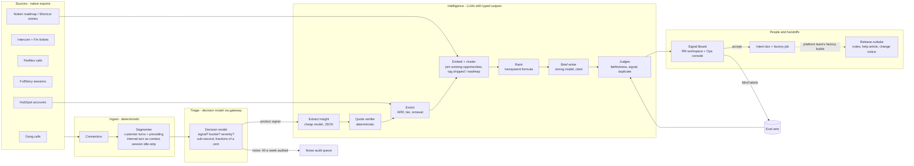

# Architecture: the Keelwater Signal Engine and the product lifecycle layer

Status: planned, build day 03/11/2026, revised after review round 1. Author: Andras Fugedi. This is the canonical design; other docs refer to it. FOUND marks a fact checked at an external source (docs/research/), INFERRED a fact reasoned from one.

## 1. What we are building and why

Keelwater's engineers already generate most code with AI, and a platform team is building the engineering factory (coding agents, guardrails, evals). The factory is a delegation meta-harness: signal in, it orchestrates people and sub-harnesses (the platform team's coding harness, Codex, a hosted or open-weight model) and passes the human gates; [docs/delegation.md](delegation.md) is its operating rules, and owning the coding harness is not required. When build effort approaches zero, the constraints move to either side of the build: deciding what to build (left) and getting what was built adopted by regulated customers (right). This repo designs and demos the **product lifecycle layer** that sits around the engineering factory, and builds one working piece of it end to end: the **Signal Engine**, which turns raw customer feedback into ranked, evidence-backed opportunities that a PM can accept in one click.

Scope of the demo (Part 2 of the task):

| In the demo | Designed, not built |
|---|---|
| Nightly intake from 5 routes (sales, support, onboarding, account management, FullStory sessions) using realistic synthetic exports | Live API connectors to the real tools |
| Fast triage with a decision model, cheap extraction, clustering, deterministic ranking, strong-model synthesis | Mockup generation for designers |
| Verified quotes and citations; three LLM judges (faithfulness, signal, duplicate) measured against PM labels; regression evals on a planted ground truth plus a held-out seed | The cluster-coherence judge; Phoenix experiments; self-hosted models inside AWS |
| Signal Board: a PM workspace (Opportunities, Handoffs) and an Ops console (Pipeline, Evals, Audit, How it works); every PM action is recorded and can become an eval label | Slack/Notion/Shortcut write-back |
| Handoff: an accepted opportunity becomes an intent document and a factory job that validates against `docs/contracts/factory_job.schema.json` | The engineering factory itself (platform team) |
| Outtake: release note, help-centre article and customer change notice drafted from a shipped story, plus a post-call follow-up brief | Auto-generated enablement videos, pull-model sales agent |

## 2. Requirements

Functional
- F1 Ingest each source in its native export shape and keep the raw record.
- F2 Separate product signal from noise before any expensive model sees it.
- F3 Extract structured insights whose quotes are verifiably present in the source.
- F4 Group insights into opportunities that persist across runs, so trends are visible week to week.
- F5 Rank opportunities with a formula a PM can read and challenge.
- F6 Write an opportunity brief where every claim cites evidence.
- F7 Let a PM accept, merge, split, reject (with a reason code), park, reassign or edit, with a 10-second undo; record who did what.
- F8 Turn an accepted opportunity into an intent document and a factory job that carries evidence references, not customer text.
- F9 Draft release-side artefacts from a shipped story for human acceptance.
- F10 Measure accuracy continuously and refuse to call a judge trusted until it is certified against blind PM labels.

Non-functional
- N1 Repeatable: every run has a manifest (data hash, config hash, prompt versions, model ids, profile, seed, batch and a fixed `as_of` date used for all recency maths). Replay reproduces a run's output hash with no API keys. The output hash excludes run ids, brief ids, the `cached` flag, timestamps, latencies and `audit_event` rows; every other id is the first 16 hex characters of a SHA-256 of its content keys.
- N2 Auditable: every model call and every human action is logged with actor, time, inputs hash, output hash, model and prompt version, and every derived row points to the call that produced it (section 7).
- N3 Private-network ready: one OpenAI-compatible model interface, so moving from the demo profile to the aws profile is a configuration change plus one re-qualification run of the eval suites. The demo runs the open weights Bedrock also serves wherever OpenRouter has them, so that run is short; judge trust is per model version and restarts at the move. SQLite to Postgres and adding SSO are code changes.
- N4 Attention and latency first, then money: triage drops noise before any LLM, so PMs see only ranked opportunities, and a nightly run fits a night at 100x volume. Token cost per nightly run is about USD 0.8, 2.6 and 21 at 1x, 10x and 100x (section 5).
- N5 Runs on a Windows 10 laptop with Python and no Docker. Demo replay finishes in under 2 minutes; a live run in under 15 minutes.

Constraints and assumptions (flagged)
- A1 Keelwater's tools: Gong (sales only, it is expensive), Fireflies (everyone else, incl. onboarding consultants and account managers), Intercom with the Fin AI agent (support), FullStory (session replay and analytics), HubSpot (accounts; messy, used only for ARR, tier and renewal date), Notion (roadmap, docs), Shortcut (tickets), Postgres with Metabase reading production directly. ASSUMED.
- A2 Customer data must stay inside Keelwater's AWS private network (VPC) in production, with a full audit trail. Data does not need anonymising, it needs auditing. Anything that leaves the VPC (the factory job) carries references and de-identified text only. ASSUMED.
- A3 All data in this repo is synthetic and invented. No public dataset was reused (licences and fit; see docs/data.md).

## 3. High-level design



Production view: the same components run inside one AWS VPC (eu-west-2). Raw exports land in S3, a scheduled Step Functions workflow runs one task per stage, Postgres (RDS, pgvector) holds the store, every model (triage included) is served by Amazon Bedrock through the `bedrock-runtime` VPC endpoint or by vLLM inside the VPC, Phoenix runs on Fargate in private subnets, and Bedrock invocation logging, CloudTrail and the hash-chained `audit_event` table provide the audit trail. Connectors reach the SaaS tools through an egress allow-list. See section 8.

## 4. The pipeline, stage by stage

The pipeline is a **workflow of typed steps, not a free-roaming agent** (ADR-001). LLMs interpret text and fill typed fields; code validates; the database enforces. Every stage reads and writes typed records (Pydantic models in `signal_engine/contracts.py`), is idempotent per `run_id`, and can be resumed from its last checkpoint. Every model call, triage included, goes through one gateway wrapper that writes `model_call` (ADR-002).

| # | Stage | Engine | Input -> output | Defensibility check |
|---|---|---|---|---|
| 0 | Connect | code | native export files -> `raw_record` with a `route` (sales, support, onboarding, account_management, sessions; null for HubSpot, Shortcut and Notion). A Fireflies call takes its route from the Keelwater host's team in `config/teams.yaml` | per-source JSON Schema; a failing record is quarantined with an audit event; raw kept for audit |
| 1 | Segment | code | raw -> `snippet`: each customer turn, with the immediately preceding internal turn attached as `context_text` (models see it, it can never be quoted); tickets split by part, Fin replies and admin notes dropped; FullStory sessions cut to interaction windows around rage, dead and error clicks | speakers mapped internal or external through attendee emails and `config/teams.yaml`; an unresolved speaker quarantines its turns; a 2-hour session becomes minutes of signal before any model runs |
| 2 | Triage | decision model through the gateway | snippet -> `triage` {is_product_signal p, bucket + confidence, severity 1-4, signal_type, decision} | thresholds below; weekly stratified audit of 40 dropped items |
| 3 | Extract | cheap LLM, JSON schema | kept snippet -> `insight` {problem, verbatim quote, workflow, desired outcome}; code copies the account from the raw record | quote must match the snippet's own text (not `context_text`) exactly or after normalisation, with the matched span stored; one retry, then rejected |
| 4 | Enrich | code | insight + HubSpot -> ARR, tier, renewal within 90 days of `as_of` | missing account data marked, never guessed |
| 5 | Cluster and tag | embeddings + LLM label | verified insights -> `opportunity` with a stable id; shipped and roadmap tags proposed | rules below; membership frozen once proposed |
| 6 | Rank | code | opportunities -> score with a visible breakdown | formula, not an LLM (ADR-004); recomputed and checked every run |
| 7 | Brief | strong LLM | top 10 opportunities -> `brief` with claims citing insight ids | every cited id must exist, be verified and belong to the opportunity (evals §3.4) |
| 8 | Judge | LLM from a different family | briefs and tagged opportunities -> `judgement` pass/fail per judge (faithfulness, signal, duplicate) with a critique | verdicts are advisory until the judge version is certified (section 6) |
| 9 | Review | PM in Signal Board | opportunity -> accept (confirm, then draft), merge, split (designed, not built in the v1 board), reject (reason code), park, reassign, edit, confirm or remove a proposed tag; 10-second undo | every action is an `annotation` and an audit event; label-panel verdicts are `label` rows |
| 10 | Handoff | strong LLM + template | accepted opportunity -> `intent_doc` (stays in the VPC) + `factory_job` (evidence references, de-identified problem statement) | validated against `docs/contracts/factory_job.schema.json`; a de-identification check rejects a job containing any quote text or account name; the factory may reject a job with a reason |
| 11 | Outtake | cheap LLM | shipped story + intent doc -> release note, help article, customer change notice; sales call + shipped features -> follow-up brief | drafts only; a human accepts each one |

### Triage gating (stage 2)

One decision-model call per snippet asks four typed questions at once, so the text is paid for once: `is_product_signal` (probability), `bucket` (choice of 10 from `config/taxonomy.yaml`), `severity` (1-4) and `signal_type` (enum, section 7). The gateway's decision-model adapter maps each backend's output to the same `triage` record.

| Condition (p = probability of product signal) | `decision` | What happens |
|---|---|---|
| p <= 0.10 | `drop` | logged; enters the weekly noise-audit sampling frame (evals §6) |
| p >= 0.50 and bucket confidence >= 0.70 | `keep` | proceeds to extraction |
| anything else | `low_confidence` | proceeds to extraction, marked; never dropped (the quote rule is the next filter) |
| backend unavailable or slow (timeout 1.5 s, two retries with backoff), then the one fallback model also fails | `untriaged` | proceeds to extraction; alert above 1% of a run |

Thresholds are per backend in `config/pipeline.yaml`, because probabilities from different models are not on one scale, and changing one is an audit event. Nothing is ever silently dropped (ADR-003).

### Extract filter (stage 3)

The extraction call, still one model call per snippet, also answers a typed field `states_product_problem` (`yes` or `no`): does the snippet itself state a product problem a squad could act on? A `no` stores no insight; the snippet gets an `extract.dropped` audit event (reason, call id, prompt version) and is counted. Reconciliation stays exact: triage ends with snippets in = keep + drop + low_confidence + untriaged, and extract prints and asserts kept-for-extract = insights + dropped_at_extract + failed (failed: a snippet too short to hold an insight, or a replay cache miss). Added because the triage model passed noise snippets at high probability and they diluted clusters (issue #7).

### Clustering (stage 5)

| Step | Rule |
|---|---|
| Text embedded | verified quote plus problem text of each verified insight; unverified insights are never clustered |
| Embedding model | demo `qwen/qwen3-embedding-8b` through OpenRouter, cached for replay; production the same open weights, or Qwen3-VL-Embedding-8B as the target (Bedrock availability not confirmed, INFERRED), as a nightly batch job, not an always-on GPU |
| Empty store | agglomerative clustering, average linkage, cosine distance threshold `cluster.distance` in `config/pipeline.yaml`, tuned on seed 42 only |
| Later runs | insights are taken in id order; each joins the nearest existing opportunity centroid if cosine similarity >= tau (1 - distance threshold); the rest are clustered among themselves with the same threshold and seed new opportunities |
| Ids and centroids | `opportunity_id` = SHA-256 of the seeding insight's id (its smallest member id); centroid = mean of member embeddings, updated after joins |
| Membership | frozen once proposed; only a PM merge or split moves insights, each an audit event. A merged opportunity points to its target. A rejected or parked one keeps its id and centroid; new evidence joining it re-proposes it only if it reaches the top 10, marked "previously rejected (reason, date)" |
| Snapshot | at accept, the member insight ids are copied into `handoff.evidence_snapshot`; later joins never change what was handed off |
| Label | a short title from the cluster-label model |

### Shipped and roadmap tagging (stage 5)

- Code ranks Shortcut stories and Notion roadmap pages by embedding similarity to each opportunity centroid. The best match above `tagging.similarity` (`config/pipeline.yaml`, tuned on seed 42) is proposed: `shipped` for a completed story, `on_roadmap` for a page with status Planned or In progress.
- A proposed tag applies to ranking at once and shows on the board as "proposed"; the PM confirms or removes it (`confirm_tag`, `remove_tag`).
- Shipped: evidence dated before the story's `completed_at` sits under the tag and is not ranked. Evidence dated after it is **post-ship feedback**: never excluded, scored on that evidence alone and listed in its own board section.
- The duplicate judge runs on every tagged opportunity. When it disagrees with a tag, the item goes to a PM queue; a tag is never removed automatically.

### Ranking formula (stage 6)

```
score         = breadth x severity x value x corroboration x recency x renewal x roadmap
breadth       = log2(1 + distinct accounts)    prospects count; insights with no resolvable account add none and are listed separately
severity      = ARR-weighted mean of insight severity (1-4); weight = account ARR, nominal ARR for prospects and unresolved insights
value         = 1 + log10(affected ARR / median customer ARR), floor 0.5; prospects at nominal ARR, unresolved insights add 0
corroboration = 1.0 for one route, 1.3 for two, 1.5 for three or more (routes, not tools: onboarding and account management both come from Fireflies but count separately)
recency       = max(0.2, share of evidence dated within 30 days before as_of)
renewal       = 1 + 0.25 x (share of affected ARR renewing within 90 days of as_of)
roadmap       = 0.5 if tagged on_roadmap, else 1.0
nominal ARR   = 0.5 x median customer ARR (prospects have no ARR in HubSpot)
```

The board shows each factor, so a PM can see exactly why an opportunity ranks where it does and argue with the weights. Weights live in `config/ranking.yaml`; a squad can change them, and every change is an audit event. On seed 42 the formula orders the six real themes from 27.6 to 13.1, the contradictory theme at 9.2 and the loud-narrow probe (one strategic, renewing account, severity 4, three routes) at 7.3 (docs/data.md §6.2).

### Handoff (stage 10)

The intent document holds the full evidence (quotes, account names) and never leaves the VPC. The factory job carries only what a coding agent outside the VPC may see. Schema v1 (`docs/contracts/factory_job.schema.json`, JSON Schema draft 2020-12):

| Field group | Contents |
|---|---|
| Identity | `schema_version`, `idempotency_key` (SHA-256 of opportunity id, evidence snapshot and intent version), `job_id`, `opportunity_id`, `action` (create, supersede, cancel), `supersedes` |
| Evidence | insight ids in the snapshot, run manifest hash, intent doc reference and hash; never quotes or account names |
| Intent | de-identified problem statement, users affected by tier and role (never by name), testable acceptance criteria (given/when/then), outcome metric with baseline, target and query, constraints, non-goals |
| Control | `data_classification` (internal or confidential; restricted data is never in a job), trace ids (opportunity, handoff, run, trace; PR, story, flag and bundle ids added by factory callbacks), gate approvals with actor, role and time |

The factory answers with accepted or rejected plus a reason code (`ambiguous_criteria`, `needs_split`, `missing_metric`, `out_of_scope`, `other`); a rejection returns the opportunity to `accepted` for redrafting. A merge supersedes or cancels open jobs of the merged opportunity. Drafting validates the job as `status: draft`; the Trio sign-off (Gate 2, done by the reviewer in the board for the demo) moves it to `submitted` and re-validates, and gate approvals are required only then.

## 5. Models and routing

One client (the `openai` Python SDK) with a configurable base URL serves every stage (ADR-002). Profiles live in `config/models.yaml`; `replay` serves recorded responses from `fixtures/llm_cache/` (free, offline, deterministic) and is the default.

| Stage | `demo` (OpenRouter; Clef for triage) | `aws` (Bedrock, eu-west-2) | `self-hosted` (vLLM in the VPC) | Why this tier |
|---|---|---|---|---|
| Triage | Clef `cloudflare/clef` (27B, open weights) through OpenRouter's Decisions API, falling back to Clef Flash `cloudflare/clef-flash` (9B, same API and key) | Clef weights self-hosted in the VPC; availability on Bedrock not confirmed (INFERRED). Thresholds fitted on labels | Clef (same weights as the demo), or a ModernBERT/SetFit classifier trained on PM labels | sub-second typed decisions; a decision model, never an LLM, so the fallback is also a decision model |
| Extract | `qwen/qwen3.8-flash` (fallback `qwen/qwen3.8-27b`) | Qwen3.8 Flash; availability on Bedrock not confirmed (INFERRED) | same weights | high volume, structured |
| Embeddings | `qwen/qwen3-embedding-8b` (fallback `openai/text-embedding-3-large`) | Qwen3-VL-Embedding-8B (open weights, the target); availability on Bedrock not confirmed (INFERRED) | same | same weights in demo and production; the VL model is not on OpenRouter, so the demo keeps Qwen3-Embedding-8B |
| Cluster labels | `qwen/qwen3.8-27b` (fallback `qwen/qwen3.8-flash`) | Qwen3.8 27B; availability on Bedrock not confirmed (INFERRED) | same weights | short labels |
| Brief and handoff, top 10 only | `deepseek/deepseek-v4.1-flash`, reasoning off (swapped from `qwen/qwen3.8-max-0902` on 05/11/2026: its reasoning is mandatory and overran the token limit) | Qwen3.8 Max; availability on Bedrock not confirmed (INFERRED) | same weights | only the top 10 reach it. Qwen 4 is the planned swap once released, qualified by the same eval suites |
| Judges | `z-ai/glm-5.3`, reasoning always on, effort low (fallback `deepseek/deepseek-v4.1-flash`) | `global.zai.glm-5.3` on Bedrock (FOUND); global routing cannot guarantee UK data residency | same weights | a different family from the brief writer (Qwen) and the extractor |
| Outtake | `qwen/qwen3.8-flash` (fallback `deepseek/deepseek-v4.1-flash`) | Qwen3.8 Flash; availability on Bedrock not confirmed (INFERRED) | same weights | short summaries |
| Synthetic data | `qwen/qwen3-vl-235b-a22b-instruct` (fallback `deepseek/deepseek-v4.1-flash`, reasoning off) | n/a | n/a | a family no judge belongs to, so no judge grades text its own family wrote; data_collection allowed for this stage only |

Model facts (docs/research/model-options-and-prices.md, section 05/11/2026; this replaces the 02/11/2026 routing):
- **Demo ids.** All ids in the demo column are FOUND on OpenRouter pages read 05/11/2026. `keelwater probe` checks each id with its real parameters; on a miss it uses the stage's fallback in `config/models.yaml` and records the swap in the run manifest.
- **Family rule.** Writers (extract, cluster labels, brief, handoff, outtake) are Qwen, with DeepSeek as fallback. Judges are GLM, with DeepSeek as fallback. A brief or handoff written by the DeepSeek fallback is never graded by a DeepSeek judge: that judgement is stored as `not_independent`, shown, and excluded from pass counts.
- **Residency.** Only GLM 5.3 is confirmed on Bedrock among these models: `global.zai.glm-5.3` and `us.zai.glm-5.3` are callable, but not in-Region in London, and OpenAI-compatible Chat Completions on bedrock-runtime is supported (FOUND, AWS model card and announcement of 05/10/2026, read 05/11/2026). Access is limited to eligible customers, and global cross-Region routing (which includes eu-west-2) cannot guarantee UK data residency. DeepSeek V4.1 Flash, Qwen3.8 (any variant), Qwen3-Embedding-8B, Qwen3-VL-Embedding-8B and Clef were not found on the AWS model card pages; for those, the `aws` profile names the open-weight model and Bedrock availability is not confirmed (INFERRED). The `self-hosted` profile serves the same weights from vLLM. Claude via the Bedrock EU inference profile (`eu.anthropic.claude-sonnet-5-5`) is an optional alternative for the brief or judge stage; that profile routes requests across EU regions (eu-central-1, eu-north-1, eu-south-1/2, eu-west-1/2/3), not only London (FOUND), so choosing it accepts EU-wide rather than UK residency.
- **Audit endpoint.** Invocation logging covers `bedrock-runtime`, not `bedrock-mantle` (FOUND). The gateway uses the runtime OpenAI-compatible path where it serves a model, else the Converse API on `bedrock-runtime`, never mantle for this traffic. It passes `call_id` as `requestMetadata` so invocation logs join `model_call`. Which path serves each id is verified at deployment (INFERRED until then).
- **OpenRouter settings.** Every request sets `provider.data_collection = "deny"` and `require_parameters = true`. Only `OPENROUTER_API_KEY` is required; demo triage calls Clef through OpenRouter's Decisions API (fields `model`, `state`, `questions`, `provider`; question types `noul`, `choice`, `score`, `box`). Demo and production can run the same open weights, and no closed hosted model sits in the triage path.
- **Egress.** The aws and self-hosted profiles allow only VPC endpoints and in-VPC hosts; OpenRouter is not on the allow-list. A test fails if any aws-profile or self-hosted base URL is outside `config/vpc_endpoints.yaml`.

Routing protects PM attention and latency as much as money: the decision model stops noise at triage, the cheap model handles volume, and only the top 10 opportunities reach the strong model. The same pattern applies to sessions: deterministic idle-stripping first, then only interaction windows reach a model. Calls run concurrently (a pool of 8 in the demo, 50 or more in production).

Cost per nightly run (INFERRED: reviewer's estimate from about 600 tokens per triage call, 1,500 in and 250 out per extraction, typical provider prices):

| Volume | Snippets | Tokens | What really costs |
|---|---|---|---|
| 1x (demo) | about 1,200 | about USD 0.8 | nothing else |
| 10x | about 12,000 | about USD 2.6 | PM review time |
| 100x | about 120,000 | about USD 21 | GPU hosting: an always-on 24 GB GPU is about USD 600-750 a month, so self-hosted models and embeddings run as a nightly batch job; 120,000 sequential calls would take 7-17 hours, which concurrency of 50 or more brings under an hour |

Build caps: the OpenRouter key carries a hard limit of USD 10 for the whole build; the per-step caps inside it total about USD 7.80 (the first live run is capped at USD 1.50 by the gateway) and the whole build is expected to cost about USD 3.50 (docs/build-plan.md section 9). Each judge is seeded with 60 items.

## 6. Accuracy: how we know it is right, and keep it right

Full design in docs/evals.md. In short:

1. **Deterministic checks first.** Schema validation, quote verification against the snippet, citation integrity, account join checks, score recomputation and the audit hash chain. These catch most hallucination for free.
2. **Planted ground truth, plus a held-out seed.** Seed 42 plants six real themes across at least three routes, two noise themes, one contradictory signal, one shipped and one on-roadmap theme, and a loud-narrow probe. Seed 43 (about 40% of the volume, three unseen themes plus one noise theme) is never used for tuning; both are reported. A two-batch replay (September, then October) checks that opportunity ids persist and no planted theme forks.
3. **Three binary judges** (faithfulness, signal, duplicate), each with a written critique. Cluster coherence is designed, not built in v1; the ground-truth purity and over-merge metrics cover it in the demo.
4. **Certification against blind PM labels.** A judge version is trusted only with at least 50 real PM labels per class on the held-out split and a Wilson 95% lower bound of at least 0.75 on both TPR and TNR (target point estimate 0.90; with 50 per class that means at least 44 of 50). Only label-panel labels made without seeing the judge's verdict count. In the demo no judge reaches trusted: the board shows "calibrating: n of 50 per class" and, per brief, which check failed or is still calibrating.
5. **Drift watch, three metrics.** Weekly label-panel agreement, noise-audit miss rate (from a fixed stratified sample of 40 drops a week, re-weighted) and PM acceptance rate.
6. **Change control.** Prompts are versioned; a model or prompt change re-runs the suites on both seeds and must pass the gates in evals §8. Phoenix experiments are designed, not built.

## 7. Data model

SQLite in the demo, Postgres with pgvector in production (ADR-007). One typed table per kind of thing; ids are the first 16 hex characters of a SHA-256 of the row's content keys unless noted.

| Table | Key fields |
|---|---|
| `run` | run_id, started_at, as_of, profile, seed, batch, data_hash, config_hash, prompt_versions, model_ids, output_hash, cost_usd, status |
| `account` | account_id, name, arr_gbp, tier, renewal_date (from HubSpot: ARR, tier and renewal date only) |
| `raw_record` | raw_id, source, route, source_id, account_id, account_status, occurred_at, payload_json |
| `snippet` | snippet_id, raw_id, speaker_email, text, context_text, start_ms, end_ms |
| `triage` | snippet_id, run_id, call_id, backend, is_signal_p, bucket, bucket_conf, severity, signal_type, decision, latency_ms, audit_weight (null unless sampled for the noise audit) |
| `insight` | insight_id, snippet_id, run_id, call_id, problem, quote, quote_match, quote_span_start, quote_span_end, workflow, desired_outcome, severity, account_id, account_status, embedding |
| `opportunity` | opportunity_id, title, problem_statement, bucket, status, squad, first_seen_as_of, centroid, merged_into, tag, tag_ref, tag_state |
| `opportunity_insight` | opportunity_id, insight_id, similarity, post_ship |
| `score` | opportunity_id, run_id, total, breadth, severity, value, corroboration, recency, renewal, roadmap, unresolved_insights |
| `brief` | brief_id, opportunity_id, run_id, call_id, body_md, citations_json, check_status, check_failures_json, prompt_version, model |
| `judge_version` | judge_version_id (`<judge>@<prompt version>+<model id>`), judge, prompt_version, model, state, n_pass, n_fail, tpr, tnr, tpr_lower, tnr_lower, state_changed_at |
| `judgement` | judgement_id, run_id, call_id, judge_version_id, judge, target_type (brief or opportunity), target_id, verdict, critique |
| `annotation` | annotation_id, target_type, target_id, actor, action, reason_code, note, undo_of, created_at |
| `label` | label_id, judge, target_type, target_id, verdict, critique, origin, blind, split, weight, actor, created_at |
| `handoff` | handoff_id, opportunity_id, intent_doc_md, factory_job_json, evidence_snapshot, manifest_hash, status, factory_reason, errors_json |
| `outtake` | outtake_id, story_ref, call_id, kind, body_md, status |
| `model_call` | call_id, run_id, stage, target_type, target_id, model, profile, endpoint, prompt_version, input_hash, output_hash, tokens_in, tokens_out, cost_usd, latency_ms, cached |
| `audit_event` | event_id, at, actor, actor_kind, action, target_type, target_id, details_json, prev_hash, hash |

Enums (identical in every doc and in `signal_engine/contracts.py`):

| Field | Values |
|---|---|
| `raw_record.source` | gong, intercom, fireflies, fullstory, hubspot, shortcut, notion |
| `raw_record.route` | sales, support, onboarding, account_management, sessions (null for reference sources) |
| `account_status` | resolved, unresolved, ambiguous |
| `run.profile` | replay, demo, aws, self-hosted |
| `run.batch` | all, sep, oct |
| `triage.decision` | keep, drop, low_confidence, untriaged |
| `signal_type` | bug, feature_gap, usability_friction, workflow_blocker, praise, churn_risk, question |
| `insight.quote_match` | exact, normalised, failed |
| `opportunity.status` | new, proposed, accepted, merged, rejected, parked, intent_drafted, in_factory, shipped, enabled, measured |
| `opportunity.tag` / `tag_state` | none, shipped, on_roadmap / proposed, confirmed, removed |
| `brief.check_status` | passed, failed_checks |
| `judge` | faithfulness, signal, duplicate (coherence reserved, not built in v1) |
| `verdict` | pass, fail |
| `judge_version.state` | uncalibrated, calibrating, trusted, revoked |
| `annotation.action` | accept, merge, split, reject, park, reassign, edit, undo, confirm_tag, remove_tag |
| `annotation.reason_code` (reject only) | not_product_signal, already_shipped, already_on_roadmap, evidence_wrong, mixed_problems, low_value, other (note required) |
| `label.origin` | real_pm, synthetic_seed, live_reviewer |
| `label.split` | dev, held_out |
| `handoff.status` | drafted, approved, sent, rejected_by_factory, superseded, cancelled |
| `outtake.kind` / `status` | release_note, help_article, change_notice, followup_brief / draft, accepted, rejected |
| `audit_event.actor_kind` | system, person |

**Lineage.** Every derived row names the call that produced it: `triage`, `insight`, `brief`, `judgement` and `outtake` carry `call_id`, and `model_call` names its `target_type` and `target_id`. A sentence in a brief therefore traces to its cited insight, the extraction call (model, prompt version, input hash), the snippet and the raw record.

**Audit events.** `audit_event` is append-only: SQLite triggers abort any UPDATE or DELETE, and in production the table sits behind an INSERT-only database role. Each row stores `prev_hash` and `hash` = SHA-256(prev_hash + canonical JSON of the row), and a deterministic check re-walks the chain every run. Events cover every status transition, annotation and label, trust granted or revoked, records quarantined, handoffs sent and factory rejections, and config changes: at run start the hashes of `config/ranking.yaml`, `config/pipeline.yaml`, `config/taxonomy.yaml` and `config/models.yaml` are compared with the previous run and any change is logged with its diff. The demo actor is the local OS user of the board session (`actor_kind` person, unauthenticated); production uses the SSO subject.

**Store lifetime.** The demo rebuilds its SQLite file on every run, so replay can match. Human actions and labels also append to `labels/human/*.jsonl` and are re-imported at run start; `--batch oct` appends to the store left by `--batch sep`. Production keeps one Postgres store.

Opportunity status machine: `new -> proposed -> accepted | merged | rejected | parked`; `accepted -> intent_drafted -> in_factory -> shipped -> enabled -> measured`; `parked -> proposed` on un-park or new evidence; `in_factory -> accepted` when the factory rejects a job. Reassign changes `squad`, not status. Each transition writes an `audit_event` with its actor. An agent can only move an item to the next state its stage owns; only a person can pass a human gate (accept, intent approval, draft acceptance).

## 8. Production deployment (designed, not built)

| Concern | Choice |
|---|---|
| Scheduling | EventBridge Scheduler triggers a Step Functions state machine nightly; one ECS Fargate task per stage; retries per state |
| Raw landing | S3 bucket per source with SSE-KMS and object lock in governance mode with bounded retention (400 days), so an authorised role can still honour a UK GDPR erasure request; connectors run in private subnets |
| Egress | allow-list to the SaaS connector APIs only; no OpenRouter; tested from `config/models.yaml` (section 5) |
| Store | RDS Postgres with pgvector; Metabase reads a reporting schema, not production tables |
| Models | Bedrock through the `bedrock-runtime` VPC interface endpoint, invocation logging on to KMS-encrypted S3 with the same retention, `call_id` in `requestMetadata`; triage in the VPC from day one; vLLM on EC2 or SageMaker as nightly batch jobs for embeddings and self-hosted models |
| Telemetry | Phoenix on Fargate in private subnets (official CloudFormation template; load balancer locked to the VPC); KMS-encrypted storage with set retention; default credentials replaced at first start from Secrets Manager |
| Secrets | Secrets Manager; nothing in code or env files committed |
| Audit | CloudTrail, Bedrock invocation logs, the hash-chained `audit_event` table (INSERT-only role, exported nightly to object-locked S3) |
| Access | PMs reach the Signal Board through the company SSO; squads see their own buckets by default |

## 9. Trade-offs we chose knowingly

| Decision | We gain | We give up | Revisit when |
|---|---|---|---|
| Workflow of typed steps over an autonomous agent | predictable cost, testable stages, clean audit | some flexibility on odd inputs | a stage needs open-ended tool use (e.g. the PM question-answering agent) |
| Decision model for triage | sub-second, fractions of a cent per item | in the demo, a hosted call to open weights (Clef) that never sees production data | production runs the same Clef weights self-hosted in the VPC and may move to a classifier once enough labels exist |
| Formula ranking | explainable, arguable, stable | misses nuance an LLM might catch | PM override patterns show a consistent bias |
| Synthetic data with a held-out seed | licence-clean, planted ground truth, a check against tuning to the answer | realism has limits | the first real export arrives |
| SQLite in the demo | runs anywhere, no Docker | no concurrency | first multi-user deployment |
| Static-renderable board | viewable without running anything | limited interactivity offline | squads adopt it weekly |

## 10. What is deliberately out of scope for the build

- Live connectors and write-back to Notion, Shortcut, Slack, Intercom.
- Mockup generation from intent documents (designed in Part 1: generated in Define on the real design-system components, signed off by the designer within the Trio gate; customer quotes and session-recording moments feed designers directly).
- The shared agent skill library (versioned, evaluated, owned by product ops, squads add their own) and the metric dictionary beyond v0 (product ops owns a v0 of about 10 lifecycle metrics in the first 60 days; the warehouse and the rest come later with data engineering).
- Enablement video generation and the sales "pull" agent (designed in Part 1).
- The cluster-coherence judge and Phoenix experiments (designed in docs/evals.md).
- Multi-tenant access control and SSO.
- The engineering factory itself, which belongs to the platform team.

## 11. Command line

One entry point, `keelwater`; each subcommand passes its arguments to its module's `main(argv)`. Every doc uses these names. Demo-profile commands need `OPENROUTER_API_KEY`; replay needs no keys.

| Subcommand | Flags | Purpose |
|---|---|---|
| `generate` | `--seed 42\|43` (42 writes `data/`, 43 writes the held-out set to `data/holdout/`), `--dry-run`, `--force`, `--max-usd <n>` | Build synthetic exports and ground truth from `generator/spec/`; `--dry-run` prints the plan and a cost estimate with no model calls |
| `probe` | `--profile demo\|aws\|self-hosted`, `--stages <list>`, `--key-usage` | One call per stage with its real parameters and `max_tokens` 32; `--key-usage` prints the OpenRouter key's usage and limit only, never the key |
| `run` | `--profile replay\|demo\|aws\|self-hosted` (default replay), `--seed 42\|43`, `--as-of DD/MM/YYYY`, `--batch all\|sep\|oct`, `--data <dir>` (default `data/raw`, or `data/holdout/raw` with `--seed 43`), `--stages <list>` (a subset of the pipeline stages, for fixture runs), `--db <path>`, `--cache-dir <dir>`, `--report-dir <dir>`, `--max-usd <n>`, `--phoenix` | Run the pipeline into a fresh store (`--batch oct` appends to the `sep` store); prints the output hash and MATCH or DIFF against the recorded run |
| `eval` | `--suite ground-truth\|judges\|holdout\|stability\|all`, `--qualify`, `--report-dir <dir>`, `--phoenix` | Score the store against ground truth, judges against labels, seed 43, or the two-batch replay; exits 0 when every floor holds; `--qualify` runs the single held-out scoring for a new judge version |
| `labels` | `seed [--n 60]`, `import <file\|dir>`, `export [--judge <name>] [--phoenix]` | Build the synthetic seed sets, load label files into the store (run does this at start), export labelled datasets |
| `handoff` | `<opportunity_id>`, `--preview` | Draft the intent doc and factory job for an accepted opportunity and validate the job; `--preview` writes without changing status |
| `board` | `serve [--host 127.0.0.1] [--port 8000] [--db <path>]` | Local Signal Board with working actions |
| `render` | `static [--out site/] [--db <path>]` | Write `site/index.html`, a static snapshot with actions disabled |
| `cache` | `prune [--dry-run]` | Delete cached responses not used by the latest run or the latest run of each eval suite |
