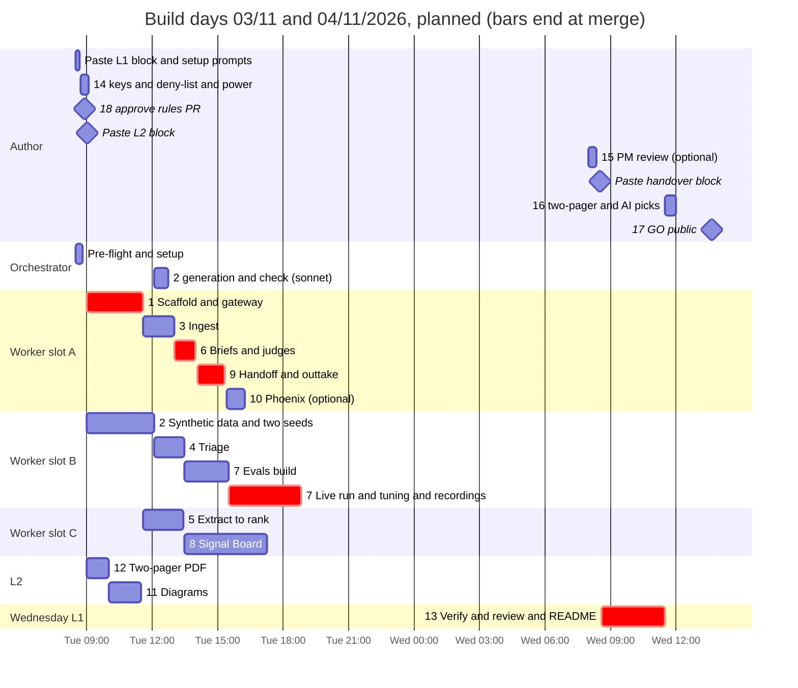

# Build plan: Demo v1, Signal Engine

Author: Andras Fugedi. Written 03/11/2026, revised after review round 1. Build day: Tuesday 03/11/2026, on one Windows 10 laptop. Verification, README and publishing: Wednesday 04/11/2026. Submission: Thursday 05/11/2026, morning.

This is how the demo in this repo gets built: who does what, in what order, how every piece is checked before it is merged, where a person must decide, and what gets dropped first if the day runs long. The design is in docs/architecture.md; this document is only about delivery.

## 1. Summary

| Item | Plan |
|---|---|
| Milestone | Demo v1: Signal Engine: 13 work orders and 5 human steps, filed first as issues #1 to #18; pull requests come after, so they never take an issue number |
| Author's morning | two pasted blocks: the L1 orchestrator (all pipeline and board work) and L2 (diagrams and the PDF), section 6 |
| Wall clock | Tuesday 08:30 to about 19:00, budgeted to 20:30 for rework; Wednesday 08:30 to about 13:45 for verification, review, the author's picks and publishing; Thursday is spare |
| Agent time | about 22 h: 20.25 h of work orders on L1 (codex terra building, sonnet subagents checking and running live steps) and 1.75 h on L2; the orchestrator runs alongside on a 10-minute timer |
| Author time | about 4 h for the whole task, including the thinking before build day (section 11) |
| Critical path | #18, #1, #6, #9, #7 (live run and recordings), then #13, #16 and #17 on Wednesday |
| Spend | the OpenRouter key's USD 10 limit is the hard stop, with at least USD 10 of account credit behind it; caps inside it total USD 7.80; expected about USD 3.50 (INFERRED from list prices) |
| Stack | Python 3.12 with uv, SQLite, FastAPI with Jinja, pytest. No Docker, no CI |
| Never cut | replay mode, quote verification, the ground-truth suite, the held-out and stability suites, the board's Opportunities and Evals tabs with undo, the human gates, the pre-publish scan, the two-pager PDF |

Why this shape:

- **Contracts first.** #1 fixes every typed record, the store schema, the CLI, the source export schemas and the model gateway, and pre-registers every subcommand, stage and hook. After that, up to three workers build different stages at once without editing the same files.
- **One orchestrator, two pasted blocks.** One Claude Code session on Opus dispatches every pipeline and board work order to codex terra workers, each in its own worktree; Sonnet subagents check each pull request and run every live step, so codex never handles keys. A second Sonnet session (L2) does the diagrams and the PDF, which need interactive Claude skills.
- **Integration is one time-boxed issue.** #7 builds the four eval suites first, then runs the whole pipeline live once, tunes on seed 42 for at most 60 minutes, freezes, scores the held-out seed once, and records everything so it replays offline.
- **Review once, at the end.** Each pull request gets a Sonnet check; one codex sol review covers the finished milestone in #13.
- **A realistic day.** The live run cannot start before about 15:30, because it waits for five stage issues. Verification moves to Wednesday morning, which keeps Thursday's submission safe.

## 2. Roles and engines

| Role | Engine and effort | Where | Does | Never does |
|---|---|---|---|---|
| L1 orchestrator | Claude Code, `opus`, effort `high` | main checkout, outside OneDrive | setup, dispatch, pushes branches, opens pull requests, posts issue comments, merges, asks the author | writes feature code; merges without a check PASS |
| Workers | codex, newest `terra`, effort `high`, through the codex plugin | `.worktrees/issue-N`, one per issue, at most 3 at once (the laptop's limit) | build and test offline with FakeGateway and replay; commit and report | run live steps, push, comment, merge, start other agents |
| Checkers and live runners | Sonnet subagents of the orchestrator, effort `high` | `.worktrees/check` (detached) or the issue's worktree | check each pull request in at most 10 lines; run probes, smokes, live runs and #7's tuning; impeccable and playwright-cli passes | start other agents |
| Fallback builder | a Sonnet subagent | the issue's worktree | builds when the codex 5-hour window has under 30% left | |
| L2 | Claude Code, `sonnet`, effort `high` | `.worktrees/L2` | #12 then #11; opens its own pull requests | merges |
| Adversarial reviewer | codex, newest `sol`, effort `medium` | a separate clean clone, inside #13 | one scoped review of the finished milestone | per-PR review loops |
| Author (repo owner) | a person | laptop and GitHub | two morning pastes, one handover paste, the five human steps, decisions, publishing | tedious work an agent can do; routine merges |

One level of delegation only: workers and subagents never start further agents. The rules every agent follows are in AGENTS.md; the permissions are in `.claude/settings.json`, approved with it in #18.

## 3. Work orders

| # | Work order | Run by | Depends on | Agent h | Merged by |
|---|---|---|---|---|---|
| 1 | Scaffold, contracts, store, CLI and model gateway with replay | L1 worker | #18 | 2.5 | Tue 11:35 |
| 2 | Synthetic data: seed 42, held-out seed 43 and planted ground truth | L1 worker | #1 to integrate; #14 to generate | 2.0 | 12:45 |
| 3 | Ingest: connectors, segmenter with context turns, FullStory idle-strip and account resolution | L1 worker | #1 | 1.25 | 13:00 |
| 4 | Triage: decision model through the gateway, one fallback, gating and stratified noise audit | L1 worker | #1, #14 | 1.0 | 13:30 |
| 5 | Extract, quote verifier, clustering, roadmap tagging and ranking | L1 worker | #1, #14 | 1.5 | 13:25 |
| 6 | Opportunity briefs, citation checks and three judges | L1 worker | #1, #14 | 1.0 | 14:00 |
| 7 | Eval suites (ground truth, held-out, stability, judges), first live run and replay recording | L1 worker, then a sonnet live runner | #2; live run after #3, #4, #5, #6, #9 | 4.0 | 18:50 |
| 8 | Signal Board: PM workspace, ops console, audited actions with undo, and static export | L1 worker, then a sonnet design pass | #1 (#11 for one tab) | 3.0 | 17:15 |
| 9 | Handoff and outtake: intent document, de-identified factory job and release drafts | L1 worker | #6 | 1.0 | 15:20 |
| 10 | Phoenix tracing bridge (optional) | L1 worker | #6 | 0.5 | 16:15 |
| 11 | Archify diagrams A, B and C | L2 | #18 | 1.0 | 11:30 |
| 12 | Two-pager PDF from Part 1 | L2 | #18 | 0.75 | 10:00 |
| 13 | End-to-end verification, adversarial review and README | fresh L1 orchestrator | #7, #8, #9 (#10) | 2.5 | Wed 11:30 |
| 28 | Delegation ruleset, model evidence and build telemetry (Part A docs PR from the planning chat; Part B CSV and measured section) | Part A planning chat; Part B L2 | Part A none; Part B #9 and every other build work order | 0.75 (Part B) | after #13 (Part B) |

"Merged by" includes the Sonnet check and the orchestrator's squash merge. L1 totals 20.25 h of work across three worker slots; L2 1.75 h.

| # | Human step (label `needs:human-action`, assigned to the repo owner) | When | Time |
|---|---|---|---|
| 18 | H5: approve AGENTS.md, the template and `.claude/settings.json` (rule and permission gate) | Tue 08:50 | 10 min |
| 14 | H1: OpenRouter credit (at least USD 10) and a key with a USD 10 limit, `.env` in the main checkout, the deny-list in the home folder, mains power and no sleep | Tue 08:45 | 20 min |
| 15 | H2 (optional): act as the PM and review 20 items in the board | Tue about 19:15, or Wed 08:00 | 20 min |
| 16 | H3: review the two-pager; pick the real AI-override examples | Wed about 11:30 | 30 min |
| 17 | H4: GO to make the repo public after the final scan (publishing gate) | Wed about 13:30 | 15 min |

## 4. Timeline



Float: #7's build finishes about 15:30, when #9 merges; the live run then starts. #3, #4 and #5 merge by 13:30, two hours before the live run needs them. #8 merges about 17:15, well before #13. Worker time after 16:15 (slots A and C) absorbs rework and cut-list fallbacks.

### Hour by hour

| Time | Orchestrator | Slot A | Slot B | Slot C | L2 | Author |
|---|---|---|---|---|---|---|
| Tue 08:30 | pre-flight, setup (section 13) | | | | | pastes L1 block; answers setup prompts |
| 08:45 | opens the #18 pull request | | | | | #14; #18 GO |
| 09:00 | dispatches #1, #2 | #1 | #2 (spec, code) | | #12 | pastes L2 block |
| 10:00 | merges #12 | #1 | #2 | | #11 | |
| 11:15 | #1 probe (sonnet, after #14) | #1 | #2 | | #11 | |
| 11:35 | merges #1 and #11; dispatches #3, #5 | #3 | #2 (rebase, wiring) | #5 | done | |
| 12:05 | #2 generation (sonnet); dispatches #4 | #3 | #4 | #5 | | |
| 12:45 | merges #2 | #3 | #4 | #5 | | |
| 13:00 | merges #3; dispatches #6 | #6 | #4 | #5 | | |
| 13:30 | merges #4, #5; dispatches #7, #8 | #6 | #7 build | #8 | | |
| 14:00 | merges #6; dispatches #9 | #9 | #7 build | #8 | | |
| 15:20 | merges #9; dispatches #10 | #10 | #7 live run | #8 | | |
| 16:15 | merges #10 or closes it | free | #7 tuning | #8 design pass | | |
| 17:15 | merges #8 | free | #7 seeds, seed 43, stability | free | | |
| 18:50 | merges #7; writes the handover on #13 | | | | | |
| to 20:30 | slack for rework and fallbacks | | | | | |
| Wed 08:00 | | | | | | #15 (optional) |
| 08:30 | fresh session: #13 | #13 scan script | live runner | README | | pastes handover block |
| 11:30 | merges #13 | | | | | #16 |
| 12:00 | pull request with the author's picks; PDF re-render | | | | | |
| 13:15 | final scan on #17 | | | | | #17 GO, approves `gh repo edit` |
| Thu 05/11 | | | | | | submits the repo link and the PDF |

## 5. Who builds what, in one picture

Each L1 work order follows the same path: the orchestrator creates the worktree and posts "Started"; a codex worker builds and tests offline; a Sonnet subagent runs the live steps the issue lists; the orchestrator pushes and opens the pull request; another Sonnet subagent checks it; on PASS the orchestrator squash-merges it with `gh pr merge --squash`, tests main and closes the issue. L2 builds and opens its own two pull requests, which the orchestrator checks and merges the same way.

## 6. The author's pastes

Morning, block 1. Open Claude Code in the main checkout, choose the model and effort below, and paste:

- Machine: `laptop` (L1, main checkout)
- Model: `opus`
- Effort: `high`
- Parallel: `yes, with L2 (start L2 once #18 is merged)`

```
Clone https://github.com/fugedibobo/Keelwater_Agentic_Software_Factory.git into a folder outside OneDrive and work inside it. Then implement milestone Demo v1: read AGENTS.md (from PR #20 if not yet merged) and docs/build-plan.md, run the setup in section 13 and the dispatch loop in section 7.
```

Morning, block 2, once #18 is merged. Open a second Claude Code session in `.worktrees/L2` of the main checkout and paste:

- Machine: `laptop` (L2, `.worktrees/L2`)
- Model: `sonnet`
- Effort: `high`
- Parallel: `yes, with L1`

```
Implement #12, then #11: read AGENTS.md first.
```

Handover, when the orchestrator asks (planned Wednesday 08:30; Tuesday evening if the author is still at the desk). Open a fresh Claude Code session in the main checkout and paste:

- Machine: `laptop` (L1, main checkout)
- Model: `opus`
- Effort: `high`
- Parallel: `no, wait for the handover comment on #13`

```
Resume milestone Demo v1 from the handover comment on #13: read AGENTS.md and docs/build-plan.md first.
```

Every work-order issue also carries its own four-bullet header and an `Implement #N` block, so any one of them can be run alone in an `opus` session in the main checkout.

## 7. How the orchestrator dispatches and checks

1. **Queue.** An issue is ready when everything in its "Depends on" line is merged. The orchestrator re-derives this from GitHub issue and pull-request state on every check, never from memory, so a missed note cannot strand work. At most 3 codex workers run at once; the critical path (#1, #6, #9, #7) goes first, then whatever unblocks most.
2. **Dispatch.** `git worktree add .worktrees/issue-N -b issue-N-slug origin/main`; a "Started (L1, terra)" comment; then a codex terra worker at effort high through the codex plugin, given the issue body verbatim (`gh issue view N --json body`) plus: "Build and test offline only. No live steps, no push, no comments, no other agents. Commit on the branch and report the changes, the test command with counts, and tokens used."
3. **Live steps.** When the worker has committed, a Sonnet subagent in the same worktree runs the issue's probe and live commands within its cap and returns their output. Keys load from the main checkout's `.env`; codex never runs a live command.
4. **Pull request.** The orchestrator pushes the branch and opens the pull request: the worker's report, the live outputs, the Done-means checklist and `Refs #N`.
5. **Check.** A Sonnet subagent checks out the pull-request head in `.worktrees/check` (detached), runs `uv sync` and `uv run pytest -q`, compares the counts, and reads the change against Done means, file ownership, the contracts, the gates, determinism and secrets. After #7 has merged it also runs `uv run keelwater run` there and needs MATCH. It returns at most 10 lines: PASS, or REWORK with the failing items. The orchestrator posts that verbatim on the pull request.
6. **Rework.** REWORK goes to a fresh codex worker as a short brief listing the failing items, not to the finished session. After three failed fixes of one problem the orchestrator posts needs-decision with one diagnostic question.
7. **Merge.** After a check PASS (and, for a gated pull request such as #18 or #16, the author's written GO): `gh pr merge --squash <P>`, which `.claude/settings.json` allows without a prompt; workers and L2 never merge, and nobody pushes to main (denied). Then `git pull --ff-only` and `uv run pytest -q` on main in the main checkout, the final report comment on the issue, `gh issue close` with the squash commit SHA, and `git worktree remove`.
8. **Watch.** A 10-minute timer (`/loop 10m`) drives every check: worker progress, L2's pull requests, answers to needs-decision comments, codex and Claude usage. A worker silent for 30 minutes is stopped and re-issued smaller. With under 30% of the codex window left, the next build goes to a Sonnet subagent and the report says so.
9. **Handover.** Once #7 has merged, the orchestrator posts a handover comment on #13 (merged issues, open pull requests, spend so far, codex window, what comes next) and asks the author for the handover paste. It hands over earlier if its context passes about 75%.
10. **Escalate.** The author is asked only for a human-step issue, a needs-decision comment, a second review BLOCK, spending above a cap, or a problem still failing after three fixes.

Issue comments stay to three per issue (Started, needs-decision if any, final report). Every final report carries a plain-English summary, the Done-means evidence, test counts, live spend, the places where a worker's output was rejected or corrected, a tokens table per engine and the remaining codex window. Those override lines are also the raw material for the README's "How I used AI" section.

## 8. Gates

| Gate | Who passes it | Where |
|---|---|---|
| Rule and permission files: AGENTS.md, `.claude/settings.json`, `.github/` | the author | #18, before any work order starts |
| Secret values, account credit and the key limit | the author | #14 |
| Each merge | the orchestrator, with `gh pr merge --squash` after a Sonnet check PASS (a gated pull request also needs the author's written GO); nobody pushes to main | every pull request |
| Spending above an issue's cap | the author | needs-decision comment |
| Publishing: making the repo public | the author, after a clean scan | #17 |
| Installs from a URL or git ref; deleting outside an agent's own work | the author | needs-decision comment |
| Adversarial review | codex `sol`, effort `medium`, once; findings fixed with a failing test first; one scoped re-check; a second BLOCK goes to the author | #13 |
| Regression | the seed 42, seed 43 and stability floors, and replay printing MATCH on main after every merge from #7 on | #7 onwards, #13 |

The product's own gates (a PM accepting an opportunity, approving an intent document, accepting a draft) are enforced in code: only a person can pass a human gate, and every move writes a hash-chained audit event.

## 9. Spend plan

All model calls go through OpenRouter on one key with a hard USD 10 limit. Each live step starts with `uv run keelwater probe` and runs with `--max-usd`; the gateway aborts a run that passes its cap.

| Issue | Live step | Cap (USD) |
|---|---|---|
| #1 | probe | 0.05 |
| #2 | generation: seed 42 (0.90) and seed 43 (0.30) | 1.20 |
| #4, #5, #6, #9 | smokes on fixtures | 0.30 in total |
| #7 | first live run (1.50) plus two tuning re-runs (0.25 each) | 2.00 |
| #7 | seed sets (60 items per judge) and judge qualification | 1.75 |
| #7 | seed 43 run (0.40) and the two stability batches (0.30) | 0.70 |
| #13 | canonical read-through run (cache misses only) | 0.30 |
| #13 | fresh live proof: 1.3 x #7's measured first-run cost, needs-decision above 1.50 | 1.50 |
| | **Total of caps** | **7.80** |

Expected spend is about USD 3.50 (INFERRED from list prices and the volumes in docs/data.md; the reviewer's estimate is about USD 0.8 per full run). Replay costs nothing, and caching means a re-run pays only for calls whose inputs changed. `uv run keelwater probe --key-usage` shows the key's usage and limit without the key.

## 10. Cut list

If the day runs behind, cut in this order, which is the order of time saved on the critical path. Each item says what it saves.

1. **#10 Phoenix bridge** (0.5 h of a worker slot plus a check). The model_call and audit_event tables remain the record (ADR-010).
2. **FullStory stretch** in #3 (about 15 min): exception-event windows and the session timeline view. Deterministic idle-strip and rage, dead and error-click windows stay.
3. **Post-call follow-up brief** in #9 (about 15 min, on the critical path because #7's live run waits for #9). Release note, help article and change notice stay.
4. **Live-mode polish** in #7 (about 15 min): progress output and friendlier error text. Replay is unaffected.
5. **impeccable passes beyond `detect`** in #8 (about 20 min).
6. **Board extras** in #8, in the spec's order (about 30 min): Audit filters, then drift lines, then the drill-down side panel (a plain page instead).
7. **Diagram B** in #11 (about 20 min, off the critical path, so last). Diagrams A and C stay; B's content remains as the Mermaid chart in docs/architecture.md.

Never cut: replay mode, quote verification, the ground-truth, held-out and stability suites, the board's Opportunities and Evals tabs with audited actions and undo, the human gates, the pre-publish scan, the two-pager PDF. Anything cut is listed in the README with the reason.

## 11. Time budget: author and agents

| When | Author's own time | Duration |
|---|---|---|
| 02/11 and early 03/11 | Read the brief; diagnosis; choose the Part 2 build; direct and review the design docs, the reviews and the Part 1 draft | 2 h 15 min |
| Tue 08:30-09:05 | Paste the L1 block and answer setup prompts; #14; #18; paste the L2 block | 37 min |
| Tue during the day | Answer up to three needs-decision comments (merges need no approval) | 10 min |
| Wed 08:00 | #15 PM review (optional) | 20 min |
| Wed 08:30 | Paste the handover block | 2 min |
| Wed 11:30 | #16 two-pager review and AI-override picks, then approve that pull request | 30 min |
| Wed 13:30 | #17 final read and GO public | 15 min |
| | **Total** | **about 4 h 10 min** (3 h 50 min without #15) |

| Agents | Time |
|---|---|
| L1 work orders: codex `terra` building, Sonnet checking and running live steps | about 20.25 h across three worker slots (19.75 h without #10) |
| L2 (`sonnet`): #12 and #11 | about 1.75 h |
| Orchestrator (`opus`) | Tue 08:30-19:00 and Wed 08:30-13:45 wall clock, mostly waiting on its 10-minute timer |
| Adversarial review (codex `sol`, medium) | about 20 minutes, once |

## 12. Risks and mitigations

| Risk | Early sign | Mitigation |
|---|---|---|
| codex usage runs out by midday (ChatGPT Plus) | codex reports under 30% of its window | Sonnet subagents build the rest on Claude Max; the report says so; the critical path keeps priority. |
| Gated pull requests wait for the author | #18 or #16 open while the author is away | Only #18 and #16 need his written GO; every other merge is the orchestrator's after a check PASS. The author's desk window is Tuesday 08:30-19:00. |
| Orchestrator context fills up | context passes 75% | Sonnet subagents do every pull-request check and return at most 10 lines; the planned handover after #7; never /compact. |
| The live run starts late | #9 or a stage issue still open at 15:30 | Critical-path dispatch order; cut items 2 and 3 first; #7's suites are built and tested offline before the live run. |
| A seed 42 floor fails | #7's ground-truth suite shows FAIL | A 60-minute tuning box on seed 42 only, at most two re-runs, thresholds and prompt text only. Then the honest result with needs-decision; nobody re-runs an unchanged configuration hoping for a luckier draw. |
| Seed 43 or the stability replay fails | holdout or stability FAIL | One fix, checked on seed 42 only, then one re-run of seed 43; otherwise the honest result is reported. Seed 43 is never used for tuning. |
| `cloudflare/clef` unavailable or slow on OpenRouter | probe fails for the triage stage; HTTP 429 | Triage runs on Clef Flash (`cloudflare/clef-flash`, same Decisions API and key) and the run says so once. Backoff on 429 and 529. |
| OpenRouter ids drift (several demo ids are INFERRED) | probe shows a primary miss | Each stage has a fallback id in `config/models.yaml`; the swap is recorded in the pull request and the run manifest. Replay is unaffected. |
| No credit behind the key | HTTP 402 on the first probe | #14 step 1 checks for at least USD 10 of credit; a key limit adds none. |
| Windows path and encoding traps | SQLite or .venv errors in OneDrive; MAX_PATH errors; hashes differ across machines; a crash printing "≥" or "£" | Repo in a folder outside OneDrive; `core.longpaths`; `.gitattributes` with `eol=lf` in the first commit; UTF-8 stdout and `encoding="utf-8"` everywhere. |
| Replay drifts from the live run | replay prints DIFF | Content-hash ids, the documented hash exclusions, a fixed `as_of`, a fresh store per run, cache-only replay, and MATCH on main after every merge from #7 on. |
| Phoenix install fails on Windows (C++ build tools) | `uv sync --extra phoenix` errors | Optional, 15-minute time box, closed as not planned; nothing depends on it. |
| Archify layout needs repair rounds | overlaps or crossing edges in the PNGs | Two repair rounds per diagram; B falls back to Mermaid; L2 runs off the critical path. |
| Two-pager runs to three pages | page count in #12 | Stylesheet first; word trims capped at 5% and listed for the author in #16. |
| Workers collide on the same files | a pull request will not rebase cleanly | File ownership per issue; subcommands, stages and hooks pre-registered in #1; contracts change additively only. |
| Laptop sleeps or slows | sessions stall | Mains, lid open and AC sleep timeouts at "never" (#14); at most 3 codex workers plus L2; no Docker. A manual hibernate pauses everything until the laptop wakes. |
| A secret or a private name leaks on publish | scan hit | `.env` git-ignored from the first commit and denied to Claude; the scan covers tracked and untracked files, full history with commit messages and pull-request heads, and issue and pull-request text; publishing only on the author's GO. |

## 13. Setup and conventions

Pre-flight, step 0, by the orchestrator at 08:30 (results posted on #14 once it is filed):

- The repo folder is not under OneDrive. It already holds `docs/`, `README.md`, `AGENTS.md`, `.github/`, `.claude/`, `.gitattributes` and `.gitignore`.
- `git --version`; `uv --version`; `uv python find 3.12` (if missing, `uv python install 3.12` is a download, so it waits for the author's approval).
- `gh auth status` shows the `repo` scope; `codex` is logged in and the codex plugin answers; Claude and codex usage left.
- `node --version`; `playwright-cli` and a browser installed; `npx impeccable` available; the Archify skill installed; Edge found in one of the Program Files folders.
- Free disk at least 10 GB.
- `powercfg /query SCHEME_CURRENT SUB_SLEEP STANDBYIDLE` and `HIBERNATEIDLE`: the AC values, plus the exact command to restore them later.

Setup, 08:30 to 08:50:

The repo, the 18 issues (#1-#18) and the gated PR #20 (AGENTS.md, `.claude/settings.json`) already exist on GitHub, and main already holds `docs/`, `README.md`, `.github/`, `.gitattributes` and `.gitignore`.

1. Clone into a folder outside OneDrive and run `git config core.longpaths true`.
2. Confirm issues #1-#18 are open and PR #20 is open (the author approves and merges it as #18; until then AGENTS.md is read from the PR branch).
3. Labels already exist from issue filing; use the label set on the issues, no milestone object (track the milestone by the issue list).
4. Post the pre-flight results on #14.
5. Branch `issue-18-agents-md` with AGENTS.md, `.github/ISSUE_TEMPLATE/work-order.md` and `.claude/settings.json`; open the pull request "Add AGENTS.md, the work-order template and Claude Code permissions" and link it from #18.
6. After #18 merges: `git worktree add .worktrees/L2 main` for L2 and `git worktree add --detach .worktrees/check` for checks. Per-issue worktrees are created at dispatch.

Conventions:

- Branches `issue-N-slug`, one per issue, from `origin/main`; squash-merged by the orchestrator with `gh pr merge --squash` after a check PASS; nobody pushes to main.
- `.env` exists only in the main checkout; the loader finds it from any worktree through git's common directory, and a separate clone (such as #13's clean clone) has no keys.
- Local stores and scratch live in `.local/` and `.scratch/`, both git-ignored; every `run` rebuilds its store. Committed outputs: `data/`, `data/holdout/`, `generator/cache/`, `fixtures/llm_cache/`, `labels/`, `reports/`, `site/`, `docs/diagrams/`, `docs/screenshots/`, the two-pager PDF.
- Every work order ends with a teardown: scratch deleted, processes stopped, free disk reported before and after.

## Planning session handover (03/11/2026)

- State: plan v1 merged to main (PR #19). Work orders are issues #1-#13; human steps #14-#18 are assigned to the author. PR #20 (AGENTS.md and .claude/settings.json) waits for the author's approval as #18.
- Done overnight: grilling interview; six research reports (docs/research/); architecture, evals, data, board, decisions, diagram specs and the factory-job contract; Part 1 draft (1,246 words); README; build plan; three adversarial reviews (product leadership, engineering leadership, one-day feasibility) and two fix rounds; byte-exact publishing checked against blob hashes.
- Next: Tuesday morning the author does #14 and #18, then pastes block 1 (L1) and, once #18 is merged, block 2 (L2) from section 6. Wednesday 08:30: handover paste, #13, then #16 and #17. Thursday morning: submit.
- Decisions taken without the author (vetoable): production triage runs inside the VPC from day one, Jev is demo-only; demo models are open weights that Bedrock also serves where possible; three judges built (coherence designed only), certified on a Wilson lower bound of at least 0.75 with at least 50 real PM labels per class, so no judge is trusted in the demo; held-out seed 43 and a two-batch stability replay against overfitting; factory job carries evidence references and a de-identified problem, never quotes; OpenRouter key limit USD 10; one orchestrator dispatching codex workers so the author pastes two blocks; work orders use Markdown headings (the work-order template) while AGENTS.md uses tagged sections.
- Risks: model ids drift weekly (the probe catches it); Jev signup or limits (one fallback, Jev optional); Phoenix install on Windows (optional, cut first); Archify layout repair rounds; the live run cannot start before about 15:30 on Tuesday.
- Lessons: a published brief and review findings should be passed to subagents as files, not retyped; push early, because the session limit stopped two subagents mid-task; every cross-document number (judge count, thresholds, spend caps, CLI names) needs one canonical home, here docs/architecture.md, or parallel writers drift.

## Planning chat 2 handover (04/11/2026 03:00)

- **State:** the build started on 04/11/2026 at 00:44 (one day late). The L1 handover is on #13 (02:22). Merged so far: #1, #3, #4, #5, #6, #8, #9 and #11 (diagram B cut, accepted by the author). The #12 two-pager fixes moved into #38. #2 is blocked on data generation. The author ruled on #2 that generation uses a free OpenRouter model, falls back to DeepSeek V4.1 Flash or Qwen, and never uses Mistral or the judges' family (comment on #2).
- **Author decisions in this chat (vetoable only by the author):** demo triage is Clef (`cloudflare/clef`) through OpenRouter's Decisions API, with no TypeSafe key (#4, PR #25, PR #31). Phoenix is mandatory, with traces, labelled datasets and eval experiments (#10). Cheaper engines build non-crown-jewel work (agy, Terra, Sonnet, Haiku), and Opus orchestrates only. A delegation ruleset with published benchmark evidence, plus Clef as router and telemetry triager (#28, PR #29). A gap review against the six Part 1 questions led to four new work orders: #37 halving model and board tracker, #38 Part 1 revision (two pages), #39 How I used AI, and #40 the presentation deck (6-8 slides, TLDR first). Author time is about 2 hours by 02:30 on 04/11, within the 4-hour ask.
- **Open PRs from this chat:** #25 (docs: Clef), #29 (delegation ruleset), #31 (AGENTS.md: Clef and checkout path, approved by the author). Merge them in that order after a Sonnet check PASS.
- **Pending author decision:** AGENTS.md line 17 says "Never /compact", which makes build sessions hand over instead of compacting. The proposed change lets build sessions auto-compact after posting a checkpoint comment; planning chats still hand over.
- **Next:** the L3 session runs #37, then #38, and #39 in parallel. #40 runs after #37, #38, #39 and #28 Part B. L1 continues #2, #7, #10 and #13. Submission is Thursday 05/11/2026, morning.
- **Lessons:** a Claude Code handover line pasted into the planning chat is meant for a build session, so check before acting on it; retyped files drift, so compare hashes before trusting a copy; keep the brief outside git (it was saved inside the checkout and excluded locally through .git/info/exclude).

## As executed (04/11/2026, written from GitHub at the end of #13)

Times are UTC, which is London time in November. Sources: the final report comment on each issue and the merged pull request list. FOUND means read there; INFERRED means reasoned. Where a report says "about" or "estimated", so does this section.

### What ran when

The build started at 00:44 on Wednesday 04/11/2026, a day later than planned (the plan assumed Tuesday 08:30). Merge times are the squash-merge times of the pull requests.

| Issue | Pull request | Merged | Result |
|---|---|---|---|
| #12 two-pager PDF | #22 | 01:14 | Done, then reopened; the fixes (footnote link, split heading, link count) went into PR #44 (closing issue #38) |
| #11 diagrams | #23 | 01:17 | Partial: A and C shipped, B cut |
| #1 scaffold, contracts, gateway | #24 | 01:19 | Done (offline); the probe waited for the key |
| #6 briefs, citations, judges | #26 (rework #32) | 01:32 | Done (offline) |
| #3 ingest | #27 | 01:37 | Done (offline) |
| #5 extract to rank | #30 | 01:47 | Done (offline) |
| #2 synthetic data | #33 (offline part), #46 (generated data) | 02:00, 05:07 | Done; seeds 42 and 43 generated for about USD 0.27 |
| #8 Signal Board | #35 | 02:06 | Done (offline) |
| #4 triage | #34 | 02:11 | Done (offline), after one REWORK |
| #9 handoff and outtake | #36 | 02:20 | Done (offline) |
| #10 Phoenix bridge | #45 (code), #49 (screenshots) | 04:33, 11:48 | Partial: traces, datasets and experiments work; human labels not shown |
| #7 eval suites, live run, recording | #48, then #55 | 07:56, 13:10 | Done with floors failing; see below |
| #13 review fixes | #51, #52 | 12:22 | Review findings fixed or documented |
| #13 verification and README | this branch | after #7's last re-run | see the end of this section |

Other pull requests: #19 plan, #20 AGENTS.md and permissions (after the author's approval in #18), #25 and #31 Clef replaces Jev, #29 delegation ruleset, #42 build sessions compact normally, #43 halving model, #44 Part 1 revision, #47 "How I used AI", #53 its telemetry fill from the build CSV, #50 build telemetry, #54 the delegation cost correction, #56 and #57 presentation deck.

The plan's critical path ran #1, #6, #9, #7. In practice #7's live part waited for #2's generated data (merged 05:07) and ran between about 05:12 and 07:40, so the planned Tuesday 15:30 start moved to the early hours of Wednesday. Two author rulings after the first live run (04/11 at 11:30) shaped the rest: one capped extract filter in #7 (a single re-run on each seed, no further loop), and the fixes and limits for the adversarial review in #13.

### Engines actually used

| Engine | Planned | What happened |
|---|---|---|
| codex `gpt-6.1-terra` (high) | builder for every non-crown-jewel work order | Built #2's offline generator only. It stopped after one turn or ran out of capacity on #1 (three stops, sandbox limits), #4's rework (usage limit, reset at 03:52), #5, #6, #10 (twice) and the #13 review fixes. Its token use was never reported |
| Sonnet builders (`sonnet`, high) | fallback below 30% codex window | Built the other 11 of the 12 done or partial work orders, plus the #13 review fixes and the #7 extract filter |
| agy (Gemini Argon) | builder for #7 and #13 after the routing change | One turn on #7: it could not run commands headless without `--yolo` and wrote nothing (53k tokens, measured by the wrapper). Not used again |
| Sonnet checkers and live runners | checks and live steps | Every pull request was checked; first-check pass rate 7 of 11, with four REWORKs (#1, #4, #11, #12) |
| codex `gpt-6.1-sol` (medium) | one review at the end | Three passes on #13, not one: BLOCK at c9a5d88 (seven findings), BLOCK at e476830 and 4e2c648, BLOCK at 0447167 and bbc36a8. On 04/11 at 11:30 the author ruled that the remaining items be documented, with no third fix loop |
| Opus orchestrator | dispatch and merge | As planned |

Per-engine token totals and pass rates are generated from the build CSV in [delegation.md](delegation.md) ("Measured on this build"); Opus tokens are estimates only.

### Cut list applied

- **Item 7, diagram B** (#11): its 17 exact edge labels do not fit five stages under 1240 px. The Mermaid chart in architecture section 3 stands in.
- **Items 5 and 6, impeccable passes beyond `detect` and the board extras** (#8): inline details instead of the side panel, no funnel-to-Audit links, no counts or percent toggle, no judge-disagreement drill-down. `detect` found 0 issues.
- **#10 was not cut** but ended Partial: no PM labels exist, so the board and Phoenix show 0 human annotations.
- **#15, the optional PM review, did not run.** No judge is certified and `labels/human/` is empty.
- Everything else in the plan was kept, including replay, quote verification, the three suites, the human gates and the pre-publish scan.

### Spend by issue

Live spend on the OpenRouter key. "Estimated" means the live runner's own estimate, not metered `model_call` cost.

| Issue | Step | USD | Basis |
|---|---|---|---|
| #1 | probe | about 0.0006 | estimated, reported under #2 |
| #2 | generation of seeds 42 and 43, smokes, aborted runs | about 0.27 | estimated (caps 0.90 and 0.30) |
| #3 to #6, #8, #9, #10 | no live step while building; their smokes ran later under #7 | 0 | reports |
| #7 | first live run, 2 tuning re-runs, judge seeds and qualification, seed 43, stability | about 1.0 | estimated (PR #48; first run under 0.50 including failed attempts, final run 0.28) |
| #7 | extract-filter re-runs: seed 42 0.0824, seed 43 0.0584 (+0.0006), stability about 0.07 | about 0.21 | metered (PR #55) |
| #13 | re-recording after the stricter citation rule | about 0.10 | PR #51 |
| #13 | canonical read-through run | 0.00 | metered, every call a cache hit |
| #13 | handoff previews for three opportunities | not metered | six live calls, under the USD 0.30 cap |
| #13 | fresh live proof | 0.1708 (key usage +0.1587) | metered; run stopped at the judge stage by the budget guard under its USD 0.364 cap |
| #13 | fresh live proof, second attempt in two legs | 0.1977 (key usage +0.2049) | metered: 0.1524 to a network error at the brief stage, then 0.0453 resumed from the same cache; completed |

The reports add up to about USD 1.6. The key's own usage figure (`probe --key-usage`) read USD 4.16 of the USD 10 limit before the fresh live proof. FOUND: the two figures differ by about USD 2.5. The cause is not established; one possibility (INFERRED) is that the gateway meters only calls whose price is configured, the same weakness as the budget-cap limit in the README. The USD 10 key limit bounded the spend throughout.

### Deviations from the plan

- **Start a day late**, and the live part of #7 moved from Tuesday afternoon to the early hours of Wednesday.
- **Codex did not build.** The plan had codex terra building and Sonnet checking; Sonnet built 11 of 12 work orders. The sol review ran three times, not once, and its fixes were built by Sonnet because codex terra stalled in this setup.
- **#7 floors fail.** Seed 42 recovers 2 of 6 planted themes, seed 43 recovers 0 of 3, and stability finds 2 forked themes. The plan allowed one tuning loop (60 minutes) and a frozen held-out run; the author added one capped extract filter and stopped there. The results ship as measured, with the diagnosis in the README.
- **Judges: the plan's older GLM release replaced by GLM 5.3** (`z-ai/glm-5.3`), because the older release ignored `json_schema`.
- **Triage model** changed from Jev to Cloudflare Clef through OpenRouter's Decisions API (author, 04/11). **The synthetic-data model** changed from Mistral to Qwen3 VL 235B after Mistral returned empty output.
- **Author time** was about 2 hours by 02:30 on 04/11 (the author's estimate), inside the 4 hours asked for.

### The #13 verification itself

- **Canonical run (04/11/2026, about 13:15 to 13:45):** `keelwater run --profile demo --max-usd 0.30` read through the cache for USD 0.00 and reproduced output hash `52236e52...`. `eval --suite all` exited 1 (floors fail, see the README). The static site was re-rendered, the board screenshots refreshed with headless Edge (playwright-cli is not installed), `cache prune` deleted 872 unused cache files, and `keelwater run` printed MATCH in 54 s.
- **Fresh live proof:** the first attempt did not finish: it ran 17 min 14 s and stopped at the judge stage, because the hard budget bound the gateway reserves for concurrent judge calls left no room under a USD 0.364 cap (metered USD 0.1708). The second attempt (`--max-usd 0.65`, empty cache) ran 519 s and failed at the brief stage with one `APIConnectionError` (metered USD 0.1524, 1145 calls: triage 710 and extract 366 were the bulk). The orchestrator treated that as a transient error, not a re-run, and resumed with the same command, the same cache and `--max-usd 0.50`: it completed in 383 s (metered USD 0.0453 over 73 paid calls, 52 of them judge calls; the earlier stages were cache hits). Total 902 s (15 min 2 s) against the 15-minute target, USD 0.1977 metered, key usage 4.3292 to 4.5341 of 10 (+0.2049). The stage that limited time is INFERRED, not measured (the run report has no per-stage timings): the live triage and extract calls in the first leg. `eval --suite ground-truth` on the completed run matched the committed seed 42 report (`efe009d511d14c7d`) on every metric; its exit code is 1 because the floors fail, as recorded. Follow-up: the gateway does not retry `APIConnectionError`; one network blip killed a run.
- **Clean clone** (no `.env` present): `uv sync` 9 s, `keelwater run` 58 s with MATCH, then `eval --suite all` offline in 5 min 15 s: exit 1, seed 42, seed 43 and stability fail, judges pass, and the seed 42 and seed 43 metrics equal the committed reports exactly.
- **Reviewer passes:** see the engines table. Findings 1, 2, 7 and 4b are documented in the README Limits, as ruled.
