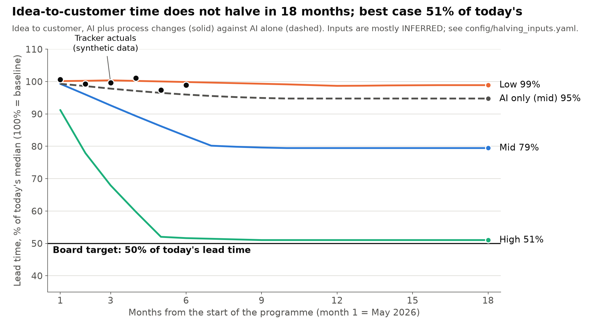

# Halving model: when delivery timelines halve

## 1. The question

When will delivery timelines halve, as the board asked?

## 2. The answer

Halving idea-to-customer is not plausible within 18 months on the mid inputs (month-18 index 79% of baseline); the high scenario reaches 51% by month 18; AI alone does not halve it (ai_only mid 95%).

For the board, AI tools alone will not halve delivery time within 18 months. Even a 90% cut to both decision latency and review wait leaves lead time at 55% of today's by month 18, so halving should not be planned for that window.

## 3. The chart

Reading: only the high scenario gets close to the board's 50% line, levelling off at 51% from about month 9. Mid settles at 79% and low at 99%.

## 4. How the model works

- Seven stage shares: discovery and decision, specification, build, review, test, release and adoption split the idea-to-adoption time. The mid shares sum to 1.00.
- AI effect, ramped: each stage's AI effect is scaled by an adoption ramp, the share of work done with AI. In the mid case it runs from 8% in month 1 to 60% by month 10, then stays flat.
- Process changes, phased in: decision, specification, review and release changes start in a set month and reach full effect over a set number of months. The mid case starts in month 2 and takes six months to reach full effect.
- Two lead-time definitions: idea to production behind a flag covers five stages, and idea to customer adds release. Adoption is shown separately and counts in neither.
- Sensitivity: each input is moved from its low to its high value, with the rest at mid, and the change in the month-18 index is recorded.

## 5. Inputs and their labels

`config/halving_inputs.yaml` holds 24 labelled inputs. A grep for `label:` counts 24 INFERRED and 0 FOUND. Some source notes cite FOUND figures, but each input's own label is INFERRED.

The eight process-change labels (seven stage effects and the phase-in) are INFERRED and set the answer. They are my reasoning from the plan, not measurements.

The two inputs that move the answer most:

1. Discovery and decision process effect: the month-18 index moves 13.1 points (85% to 72%).
2. Release process effect: 6.9 points (82% to 75%).

Review process effect ranks fourth, at 4.4 points.

## 6. What evidence would change it

- A measured stage split from the company's own tracker, replacing the INFERRED shares.
- A measured review wait. The research note says that if baseline review exceeds 12% of lead time, review becomes the largest lever.
- A decision log showing decisions taking days, not one to two months, which would shrink the discovery share.
- An adoption plateau well below the mid ramp's 60%.
- Measured effects for test, release or specification, which are currently guesses. Any stage other than decision latency and review wait could move the answer.

## 7. How the tracker is used each month

1. Replace `data/delivery/items.csv` with real stage timestamps, one row per item, using the columns in `data/delivery/README.md`.
2. Run `uv run --with matplotlib python scripts/halving_model.py --track data/delivery/items.csv`.
3. Read, for both lead-time definitions, the percentage of the way to the 50% target. Read throughput per squad against the +100% target.
4. Compare the result with the chart's scenario lines (mid 79%, high 51% at month 18).
5. Post a one-line reading to the board.

The current tracker data is invented. It shows idea-to-customer at 5% of the way to target (4.5% raw), idea-to-production behind a flag at 3% (2.8% raw), and overall throughput at 2% (2.5% raw). Do not report these to the board as real.

Sources: [delivery speed evidence](research/delivery-speed-evidence.md) and [summary](../reports/halving/summary.md).
