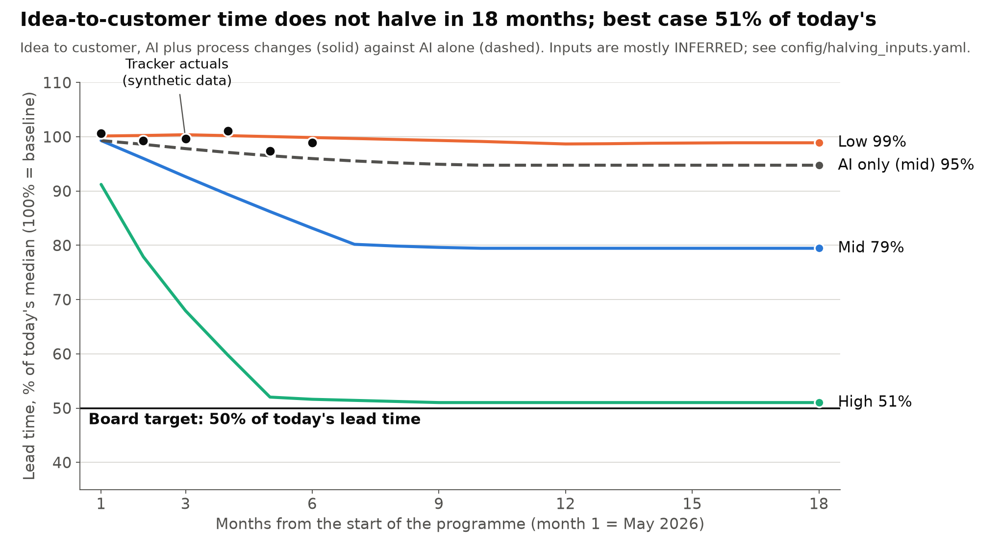

# Halving model: summary

Synthetic company, invented data. Inputs are labelled FOUND or INFERRED in `config/halving_inputs.yaml`; most are INFERRED.

## Answer

Halving idea-to-customer is not plausible within 18 months on the mid inputs (month-18 index 79% of baseline); the high scenario reaches 51% by month 18; AI alone does not halve it (ai_only mid 95%). It becomes plausible only if other stages speed up as well: even a 90% process cut of both decision latency and review wait leaves the index at 55% by month 18.

Note: the process-change effects are INFERRED (my reasoning from Part 1, not measured) and they set this answer.

## First month at or below 50% of baseline

| Scenario | Levers | idea_to_production_behind_flag | idea_to_customer | idea_to_customer at month 18 |
|---|---|---|---|---|
| low | ai_only | not within 18 months | not within 18 months | 102% |
| low | ai_plus_process | not within 18 months | not within 18 months | 99% |
| mid | ai_only | not within 18 months | not within 18 months | 95% |
| mid | ai_plus_process | not within 18 months | not within 18 months | 79% |
| high | ai_only | not within 18 months | not within 18 months | 79% |
| high | ai_plus_process | not within 18 months | not within 18 months | 51% |

## Most sensitive inputs

Swing in the month-18 idea_to_customer index (ai_plus_process), moving one input from its low to its high value with the rest at mid. The two that move the answer most: **discovery_decision process effect** and **release process effect**.

| Input | Low | High | Index at low | Index at high | Swing |
|---|---|---|---|---|---|
| discovery_decision process effect | -0.05 | -0.50 | 85% | 72% | 13.1 pt |
| release process effect | -0.10 | -0.70 | 82% | 75% | 6.9 pt |
| build AI effect | -0.04 | -0.40 | 82% | 77% | 5.0 pt |
| review process effect | -0.10 | -0.60 | 81% | 77% | 4.4 pt |
| discovery_decision AI effect | 0.00 | -0.30 | 81% | 77% | 4.2 pt |

## What would have to be true

Mid inputs, ai_plus_process, idea_to_customer. The extra process cut is added to the mid process effect (fractional points of stage time) and is solved by bisection for the index to reach 50% of baseline. Total cut is the AI plus process effect on that stage's time at the month shown. A 90% process cut is the cap.

| Lever | By month | Extra process cut | Total stage-time cut |
|---|---|---|---|
| discovery_decision | 18 | not reachable by this lever alone | index still 60% at a 90% process cut |
| discovery_decision | 12 | not reachable by this lever alone | index still 60% at a 90% process cut |
| review | 18 | not reachable by this lever alone | index still 74% at a 90% process cut |
| review | 12 | not reachable by this lever alone | index still 74% at a 90% process cut |
| discovery_decision and review together | 18 | not reachable by this lever alone | index still 55% at a 90% process cut |
| discovery_decision and review together | 12 | not reachable by this lever alone | index still 55% at a 90% process cut |

## Tracker status

Baseline is items released in months 1-3; current is items released in months 5-6. Shown percentages are clamped to 0-100%; raw is unclamped.

| Group | Measure | Baseline | Current | Raw | Of the way to target |
|---|---|---|---|---|---|
| overall | idea_to_production_behind_flag (days) | 135.8 | 133.9 | 2.8% | 3% |
| overall | idea_to_customer (days) | 154.2 | 150.7 | 4.5% | 5% |
| intake_claims | idea_to_production_behind_flag (days) | 136.7 | 128.6 | 11.8% | 12% |
| intake_claims | idea_to_customer (days) | 153.8 | 145.6 | 10.7% | 11% |
| overall | throughput (items per squad per month) | 32.2 | 33.0 | 2.5% | 2% |
| intake_claims | throughput (items per squad per month) | 32.0 | 38.5 | 20.3% | 20% |

Full tables are in `reports/halving/tracker.md`.

